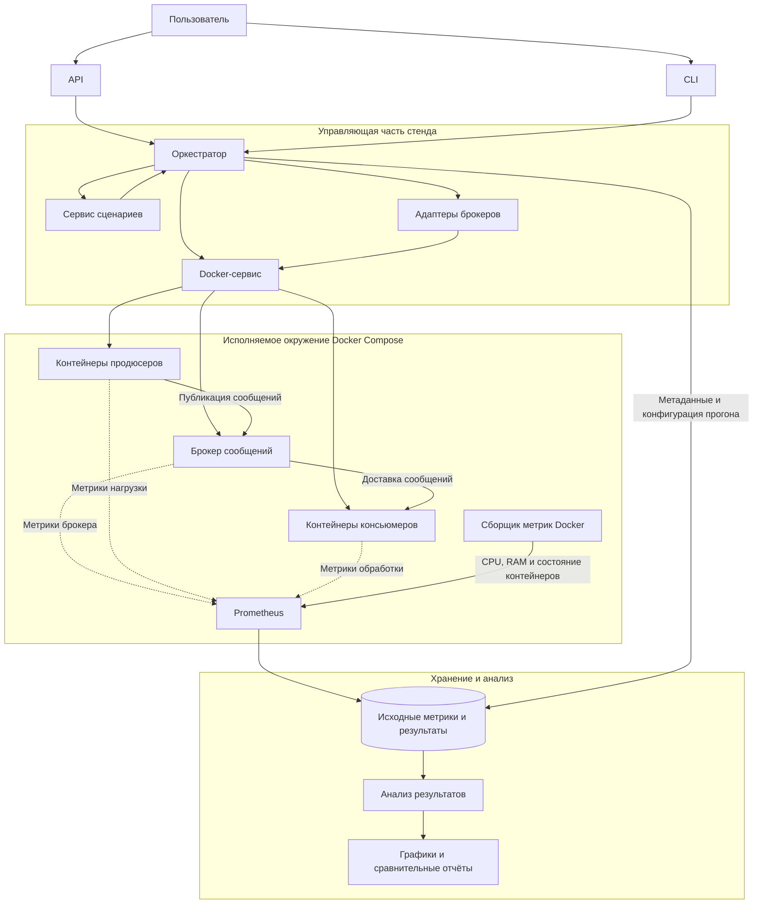

# Практическая работа 3. Критерии научности исследования и проектирование эспериментального стенда

## Анализ статей

### Таблица

| Поле                                | Maharjan et al. (2023)                                                                                                                                                                                                                                                    | Каргин (2025)                                                                                                                                                                                                                                                              | Putra et al. (2025)                                                                                                                                                                                                                                              | Макаров (2025)                                                                                                                                                                                                                                                                          | Кузьчуткомов (2020)                                                                                                                                                                                                                                                                                                                                  | Калугин (2021)                                                                                                                                                                                                                                                                                                                            |
|-------------------------------------|---------------------------------------------------------------------------------------------------------------------------------------------------------------------------------------------------------------------------------------------------------------------------|----------------------------------------------------------------------------------------------------------------------------------------------------------------------------------------------------------------------------------------------------------------------------|------------------------------------------------------------------------------------------------------------------------------------------------------------------------------------------------------------------------------------------------------------------|-----------------------------------------------------------------------------------------------------------------------------------------------------------------------------------------------------------------------------------------------------------------------------------------|------------------------------------------------------------------------------------------------------------------------------------------------------------------------------------------------------------------------------------------------------------------------------------------------------------------------------------------------------|-------------------------------------------------------------------------------------------------------------------------------------------------------------------------------------------------------------------------------------------------------------------------------------------------------------------------------------------|
| Библиографическая ссылка            | Maharjan, R. Benchmarking message queues / R. Maharjan, S.H. Chy, M.A. Arju, T. Cerny // Telecom. – 2023. – Vol. 4. – P. 298–312. – DOI: 10.3390/telecom4020018. – URL: https://www.academia.edu/104557382 (дата обращения: 04.01.2026).                                              | Каргин, Р.А. Анализ производительности распределённых брокеров сообщений RabbitMQ и Apache Kafka / Р.А. Каргин // Обработка информации и математическое моделирование : материалы Всероссийской научно-практической конференции, Новосибирск, 24 апреля 2025 г. – Новосибирск : Сибирский государственный университет телекоммуникаций и информатики, 2025. – С. 91–104. – URL: https://elibrary.ru/item.asp?id=83027014 (дата обращения: 07.05.2026).                                     | Putra, S.J. Comprehensive benchmarking of message brokers: evaluating performance and security metrics for reliable messaging systems / S.J. Putra, G. Firmansyah, B. Tjahjono, H. Akbar // Journal Locus Penelitian dan Pengabdian. – 2024. – Vol. 4, No. 11. – P. 10829–10838. – URL: https://locus.rivierapublishing.id/index.php/jl/article/view/5081 (дата обращения: 10.05.2026). | 5.	Макаров, П.С. Исследование эффективности брокеров сообщений в высоконагруженных распределённых системах / П.С. Макаров // Студенческий научный журнал. – 2025. – Вып. 18 (314). – URL: https://sibac.info/journal/student/314/373223 (дата обращения: 08.05.2026). | Кузьчуткомов Д. Н. Разработка инструмента оценки производительности систем обмена сообщениями, основанных на брокерах, и исследование с его помощью существующих решений // Инновации. Наука. Образование. 2020. № 11. С. 178–191. URL: [https://elibrary.ru/item.asp?id=42988663](https://elibrary.ru/item.asp?id=42988663\&utm_source=chatgpt.com) | Калугин В. А. Выбор брокера сообщений для использования в качестве шины данных в рамках телекоммуникационной компании // Актуальные проблемы математики, механики и информатики: сборник статей. Пермь, 2021. С. 25–32. URL: [https://elibrary.ru/item.asp?id=46446479](https://elibrary.ru/item.asp?id=46446479\&utm_source=chatgpt.com) |
| Исследовательский вопрос / гипотеза | Как различаются брокеры по пропускной способности и задержке при разных размерах сообщений и уровнях нагрузки? Формальная гипотеза не указана.                                                                                                                            | Как размер сообщений, число узлов брокера и клиентов влияют на производительность RabbitMQ и Kafka? Формальная гипотеза не указана.                                                                                                                                        | Как уровни безопасности влияют на производительность брокеров сообщений? Формальная гипотеза не указана.                                                                                                                                                         | Какой брокер лучше подходит для высоконагруженной распределённой системы с учётом производительности, надёжности и ресурсов? Формальная гипотеза не указана.                                                                                                                            | Как сравнить пропускную способность брокеров при одинаковых условиях с помощью разработанного инструмента? Формальная гипотеза не указана.                                                                                                                                                                                                           | Какой брокер подходит для шины данных телекоммуникационной компании при переходе к микросервисной архитектуре?                                                                                                                                                                                                                            |
| Объект исследования                 | Redis, ActiveMQ Artemis, RabbitMQ, Apache Kafka.                                                                                                                                                                                                                          | RabbitMQ и Apache Kafka в распределённой конфигурации.                                                                                                                                                                                                                     | Apache Kafka, Apache Pulsar, Apache RocketMQ, RabbitMQ.                                                                                                                                                                                                          | Apache Kafka, RabbitMQ, NATS в контексте автоматизированной системы проверки студенческих работ.                                                                                                                                                                                        | Kafka, RabbitMQ, ActiveMQ, NATS, Redis, Pulsar, NSQ.                                                                                                                                                                                                                                                                                                 | Apache Kafka, RabbitMQ, NATS; сравнение технических характеристик и эксплуатационных особенностей.                                                                                                                                                                                                                                        |
| Независимые переменные (факторы)    | Брокер; размер сообщения: 10 B, 100 B, 1 KB, 10 KB, 50 KB, 100 KB; нагрузка для измерения задержки: 1, 3, 6, 10, 15 MB/s.                                                                                                                                                 | Размер сообщения: 128 B, 256 B, 512 B, 1 KB; производители и потребители: 1–5 каждого типа; число узлов брокера: 1–3.                                                                                                                                                      | Тип брокера; уровень безопасности: 0 — без защиты, 1 — TLS, 2 — TLS + аутентификация, 3 — TLS + аутентификация + ACL; размер сообщения: 10 B и 1 MB.                                                                                                             | Число производителей: 1–5; нагрузка: 1 000–50 000 сообщений/мин; размеры сообщений: 10 KB, 100 KB, 1 MB; потребители: 2–4 в многопоточном сценарии; остановка брокера на 5 секунд.                                                                                                      | Брокер; тестируемая часть — производитель, потребитель или система; размер и количество сообщений; персистентность — включена/выключена, где поддерживается.                                                                                                                                                                                         | Формализованные факторы и уровни не указаны. Рассматриваются различия брокеров, их характеристики и возможности масштабирования.                                                                                                                                                                                                          |
| Зависимые переменные (метрики)      | Пропускная способность: events/s и MB/s; сквозная задержка: 50-й, 75-й, 95-й и 99-й перцентили.                                                                                                                                                                           | Максимальная частота отправки сообщений производителем; максимальная частота получения потребителем; время передачи сообщения от производителя к потребителю. Единицы: частота сообщений в единицу времени и время передачи; точные единицы в сводном описании не указаны. | Пропускная способность: events/s; задержка: мс.                                                                                                                                                                                                                  | Средняя задержка: мс; пропускная способность: сообщений/с; потери сообщений: %; CPU: %; RAM: MB.                                                                                                                                                                                        | Пропускная способность производителя, потребителя и системы в целом: сообщений/с.                                                                                                                                                                                                                                                                    | Количественные метрики и единицы измерения не указаны.                                                                                                                                                                                                                                                                                    |
| Контролируемые условия              | Один производитель и один потребитель; единый инструмент OpenMessaging Benchmark; локально установленные брокеры.                                                                                                                                                         | Общий инструмент OpenMessaging Benchmark; настройки брокеров ориентированы на надёжность. Полный набор фиксированных условий не указан.                                                                                                                                    | Общий подход к бенчмаркингу; прочие фиксированные параметры не указаны.                                                                                                                                                                                          | Три прототипа с одинаковой схемой взаимодействия, но разными брокерами; единая тестовая среда.                                                                                                                                                                                          | Одинаковые сообщения и общие параметры испытаний; стандартные конфигурации брокеров, производителей и потребителей.                                                                                                                                                                                                                                  | Не указано.                                                                                                                                                                                                                                                                                                                               |
| Стенд                               | MacBook Air 2020, Apple M1, 16 GB RAM, SSD 512 GB. Redis 7.0.9, RabbitMQ 3.11.10, ActiveMQ Artemis 2.28.0, Kafka 3.4.0. OpenMessaging Benchmark.                                                                                                                          | Четыре многопроцессорных сервера под GNU/Linux. Точные модели CPU, объём RAM, версии ПО и параметры сети не указаны в сводном описании. Используется OpenMessaging Benchmark.                                                                                              | Используется Docker. Точные характеристики оборудования, версии брокеров и параметры контейнеров не указаны в доступном тексте.                                                                                                                                  | 4 виртуальных ядра AMD Ryzen 5 3500U 2,10 GHz; 8 GB RAM; виртуальная сеть до 1 Gbit/s; SSD 256 GB. Windows 10 Pro, Java 17, Docker 24.0, Docker Compose 2.20, PostgreSQL 14, Postman Runner, Docker stats.                                                                              | MacBook Air 13″ Early 2016; Intel Core i5 1,6 GHz; 8 GB RAM. Инструмент на Java; Maven, SLF4J и клиентские библиотеки брокеров.                                                                                                                                                                                                                      | Стенд и инструменты нагрузочного тестирования не указаны.                                                                                                                                                                                                                                                                                 |
| Методика                            | Для throughput указаны 6 размеров сообщений и 5 минут на запуск; для latency — 5 уровней нагрузки и 5 минут на запуск. В статье есть несоответствие между числом перечисленных комбинаций и заявленным общим числом экспериментов. Прогрев и порядок запусков не указаны. | Варьируются размер сообщения, число клиентов и узлов. Число повторений, прогрев, длительность и порядок запусков не указаны.                                                                                                                                               | Сравнение четырёх брокеров при разных уровнях безопасности и размерах сообщений. Число повторений, прогрев, длительность и порядок запусков не указаны.                                                                                                          | Базовая нагрузка: 1 производитель, 1 потребитель, 10 000 сообщений по 1 KB; рост нагрузки: 1–5 производителей, 1 000–50 000 сообщений/мин; сообщения 10 KB, 100 KB, 1 MB; остановка брокера на 5 секунд; 2–4 потребителя. Число повторений, прогрев и длительность тестов не указаны.   | Система целиком: 1 000 сообщений по 1 KB; производитель: 100 000 сообщений по 1 KB; потребитель: 1 000 сообщений по 1 KB. По 3 запуска каждого эксперимента; отдельно проверяется персистентность. Прогрев и порядок запусков не указаны.                                                                                                            | Подтверждённая процедура нагрузочного тестирования не указана; описан сравнительный анализ характеристик и эксплуатации.                                                                                                                                                                                                                  |
| Статистическая обработка            | Представлены графики и таблицы; для задержки используются перцентили. Доверительные интервалы, разброс и статистические тесты не указаны.                                                                                                                                 | Не указано.                                                                                                                                                                                                                                                                | Сравниваются значения задержки и пропускной способности. Доверительные интервалы и статистические тесты не указаны.                                                                                                                                              | Приведены сравнительные таблицы метрик. Доверительные интервалы, разброс и статистические тесты не указаны.                                                                                                                                                                             | Средняя пропускная способность рассчитывается по трём запускам. Доверительные интервалы и статистические тесты не указаны.                                                                                                                                                                                                                           | Не указано.                                                                                                                                                                                                                                                                                                                               |
| Угрозы валидности                   | Один производитель и один потребитель; локальный стенд не отражает распределённую сетевую среду. Результаты могут отличаться при иной конфигурации и числе клиентов.                                                                                                      | Недостаточно сведений о конфигурации брокеров и серверов; результаты зависят от настроек надёжности.                                                                                                                                                                       | Недостаточно данных об окружении и настройках для независимого повторения; влияние безопасности связано с конкретными размерами сообщений.                                                                                                                       | Один виртуализированный стенд и прикладной сценарий ограничивают обобщение результатов; отсутствие числа повторений затрудняет оценку стабильности.                                                                                                                                     | Один компьютер; стандартные настройки не гарантируют оптимальность брокеров; отдельные режимы персистентности и получения сообщений не поддерживаются всеми решениями.                                                                                                                                                                               | Сравнение характеристик не следует интерпретировать как количественное сравнение производительности под одинаковой нагрузкой.                                                                                                                                                                                                             |
| Доступность артефактов              | Указаны JSON-результаты, форк OpenMessaging Benchmark и скрипты построения графиков в `/bin/charts`. Ссылка на форк: указана авторами в статье; отдельная проверка доступности не проводилась.                                                                            | Публичный код, конфигурации и исходные данные не указаны.                                                                                                                                                                                                                  | Публичный код, данные и конфигурации не указаны в доступном тексте.                                                                                                                                                                                              | Публичный код, конфигурации Docker и исходные измерения не указаны.                                                                                                                                                                                                                     | Инструмент описан в статье; публичный репозиторий и готовые конфигурации не подтверждены.                                                                                                                                                                                                                                                            | Экспериментальный код, конфигурации стенда и набор измерений не указаны.                                                                                                                                                                                                                                                                  |
| Оценка воспроизводимости (0–3)      | 2 — есть JSON и изменённый инструмент, версии ПО, оборудование и параметры тестов; окружение и некоторые детали процедуры не зафиксированы полностью.                                                                                                                     | 1 — методика и основные факторы описаны, но артефакты и подробное окружение не подтверждены.                                                                                                                                                                               | 1 — указаны основные факторы и метрики, но недостаточно сведений о стенде и протоколе запусков; артефакты не указаны.                                                                                                                                            | 1 — описаны сценарии и стенд, но публичные артефакты не подтверждены; не хватает деталей повторения экспериментов.                                                                                                                                                                      | 1 — методика и стенд описаны, но публичный код и зафиксированное окружение не подтверждены.                                                                                                                                                                                                                                                          | 0 — недостаточно сведений даже для повторения нагрузочного эксперимента; в доступном описании не указаны измерительный протокол и стенд.                                                                                                                                                                                                  |

### Синтез результатов анализа экспериментальных исследований брокеров сообщений

Анализ шести публикаций показал, что при исследовании производительности брокеров сообщений авторы преимущественно оценивают пропускную способность и задержку доставки сообщений. Дополнительно рассматриваются потребление вычислительных ресурсов, надёжность доставки и поведение систем при отказах. При этом набор измеряемых показателей, условия испытаний и степень детализации методики существенно различаются между работами.

#### Что принято измерять и как организуются эксперименты

Наиболее распространённой метрикой является пропускная способность (throughput), характеризующая количество сообщений, обработанных за единицу времени. Она измеряется в сообщениях в секунду (messages/s или events/s), а в некоторых исследованиях также в мегабайтах в секунду (MB/s). Например, Maharjan и соавторы сравнивают Redis, ActiveMQ Artemis, RabbitMQ и Apache Kafka по пропускной способности при размерах сообщений от 10 байт до 100 КБ. Кузьчуткомов отдельно оценивает производительность производителя, потребителя и системы в целом. Такое разделение позволяет исследовать не только возможности брокера принимать сообщения, но и скорость их получения и обработки.

Вторая ключевая метрика — задержка доставки (latency), то есть время передачи сообщения от производителя к потребителю. Обычно она измеряется в миллисекундах. Maharjan и соавторы рассматривают 50-й, 75-й, 95-й и 99-й перцентили задержки, что позволяет оценивать не только типичное время доставки, но и поведение системы в случаях относительно долгой обработки. В работе Макарова задержка сравнивается при базовой и повышенной нагрузке, а также при передаче крупных сообщений. Совместное использование пропускной способности и задержки важно, поскольку высокий throughput не обязательно означает малое время ожидания для отдельного сообщения.

Некоторые публикации расширяют систему метрик. Макаров рассматривает долю потерь сообщений, загрузку процессора и потребление оперативной памяти. Также в его работе предусмотрены сценарии отключения брокера и многопоточной обработки. Это позволяет оценить не только скорость обмена, но и надёжность системы при неблагоприятных условиях. Каргин исследует влияние размера сообщения, количества клиентов и числа узлов брокера на производительность RabbitMQ и Kafka. В работе Putra и соавторов отдельным фактором выступает уровень безопасности: от работы без защиты до использования TLS, аутентификации и ACL.

Таким образом, рассмотренные работы показывают несколько распространённых способов организации экспериментов: изменение размера сообщений, увеличение числа производителей и потребителей, варьирование нагрузки, сравнение конфигураций брокера и проверка влияния дополнительных механизмов, например персистентности или защиты соединения. При этом исследование только одного режима работы не позволяет сделать полноценный вывод о поведении брокера при различных эксплуатационных условиях.

### 2. Типичные недостатки экспериментальных методик

Одна из наиболее заметных проблем — неполное описание экспериментальной процедуры. В ряде публикаций не указаны продолжительность тестов, порядок запусков, время прогрева системы и число повторений.

Вторая проблема связана с неполной фиксацией окружения и настроек. Для воспроизводимого сравнения важно знать версии брокеров, характеристики оборудования, параметры сети, конфигурацию хранения сообщений и настройки производителей и потребителей. Maharjan и соавторы указывают характеристики компьютера и версии программных продуктов, а Макаров подробно описывает аппаратную и программную среду. В других работах отдельные характеристики стенда или конфигурации брокеров остаются неуказанными. Это затрудняет прямое сопоставление результатов разных публикаций.

Также необходимо учитывать ограничения самого сценария. Например, испытания с одним производителем и одним потребителем, как в работе Maharjan и соавторов, не позволяют полностью судить о поведении брокера при большом числе параллельных клиентов. Аналогично, сравнение брокеров только в стандартных конфигурациях, как у Кузьчуткомова, полезно для оценки типичного использования, но не обязательно выявляет максимальную производительность каждого решения. В работе Калугина рассматриваются характеристики и особенности эксплуатации брокеров, однако в доступном тексте не описана воспроизводимая процедура нагрузочных измерений, поэтому её нельзя использовать как равноценный источник экспериментальных результатов.

### 3. Сравнение качества методик

Среди рассмотренных публикаций наиболее подробно экспериментальная процедура представлена в работе Maharjan и соавторов. Авторы указывают версии четырёх брокеров, характеристики тестового компьютера, размеры сообщений, уровни нагрузки и продолжительность запусков. Дополнительным преимуществом является использование OpenMessaging Benchmark для разных систем и предоставление результатов в JSON, что облегчает последующий анализ данных. Вместе с тем авторы используют одного производителя и одного потребителя, а доступное описание содержит несоответствие между перечисленными комбинациями тестов и заявленным общим количеством экспериментов. Поэтому даже наиболее подробно описанная методика имеет ограничения.

Работа Макарова особенно близка к тематике исследования брокеров при высокой нагрузке. В ней рассматриваются увеличение числа производителей, крупные сообщения, многопоточная обработка и имитация отказа брокера. Также описаны аппаратная среда, программные инструменты и несколько групп метрик. Это делает работу полезной для проектирования комплексных сценариев нагрузочного тестирования. Основной недостаток — отсутствие подробностей о повторениях и статистической обработке.

Работа Каргина полезна для исследования влияния масштабирования: в ней изменяются размер сообщений, число клиентов и число узлов брокера. Использование общего бенчмаркингового инструмента повышает сопоставимость результатов. Однако неполнота сведений о стенде и протоколе испытаний ограничивает воспроизводимость.

Кузьчуткомов предлагает важный методический подход: отдельное измерение производителя, потребителя и системы целиком, а также три запуска каждого эксперимента с расчётом средней пропускной способности. Преимущество работы — ясная структура измерений и контроль размера сообщений. Ограничение заключается в использовании одного компьютера и отсутствии подтверждённых публичных артефактов.

Работа Putra и соавторов интересна исследованием влияния уровней безопасности на производительность, однако доступных сведений недостаточно для полноценного повторения эксперимента. Работа Калугина полезна для обоснования выбора брокера с учётом требований предметной области, но её следует рассматривать как сравнительно-аналитическую, а не как подтверждённый источник результатов контролируемого нагрузочного тестирования.

### Выводы для собственного исследования

Проведённый анализ показывает, что методика сравнения брокеров должна включать несколько взаимосвязанных групп показателей: пропускную способность, задержку, потребление CPU и RAM, а также надёжность доставки. Эксперименты целесообразно проводить при изменении размера сообщений, интенсивности нагрузки, количества производителей и потребителей и режима гарантии доставки. Для каждого сценария необходимо фиксировать версии брокеров, аппаратное и программное окружение, конфигурации и длительность тестирования.

Важным требованием является повторение экспериментов и сохранение исходных результатов. Помимо среднего значения желательно анализировать разброс и перцентили задержки, чтобы не ограничиваться одним агрегированным показателем. По возможности следует публиковать конфигурации запуска, исходные данные и скрипты обработки результатов.

Для разрабатываемого инструмента бенчмаркинга наиболее полезно объединить подход Maharjan и соавторов к фиксации условий и сохранению данных, подход Каргина к варьированию количества клиентов и узлов и подход Макарова к сценариям высокой нагрузки и отказоустойчивости. Это позволит не просто сравнить брокеры в одном режиме, а исследовать, как их производительность меняется при изменении нагрузки и конфигурации. Полученные результаты будут применимы к выбору брокера для конкретных условий эксплуатации, без необоснованного объявления одного решения универсально лучшим.

## Критерии научного исследования

| Критерий	                            | Как он будет выполнен в ВКР                                                                                                                                                                                                                                                                                                  | 
|--------------------------------------|------------------------------------------------------------------------------------------------------------------------------------------------------------------------------------------------------------------------------------------------------------------------------------------------------------------------------|
| Объективность и измеримость	         | Производительность оценивается по заранее определённым количественным метрикам: пропускная способность, перцентили задержки, потребление CPU и RAM, доли потерь и дубликатов. Единицы измерения и способы вычисления фиксируются до проведения экспериментов.                                                                |
| Контроль переменных	                 | В каждом сценарии изменяется один основной фактор либо заранее определённая группа факторов. Остальные параметры фиксируются. Например, при исследовании размера сообщения сохраняются постоянными интенсивность 100 сообщений/с, один производитель, один потребитель и гарантия At most once.                              |
| Повторяемость (repeatability)	       | Каждый сценарий выполняется несколько раз на одном стенде с одинаковыми версиями ПО, конфигурациями и параметрами нагрузки. Результаты запусков сохраняются отдельно, после чего сравниваются для оценки разброса. Точное число повторений необходимо определить до основного эксперимента.                                  |
| Воспроизводимость (reproducibility)	 | Другому исследователю предоставляются код инструмента, конфигурации брокеров, Docker Compose, параметры сценариев и инструкции запуска. Для фиксации окружения используются конкретные версии и идентификаторы образов контейнеров. Исследователь должен иметь возможность повторить испытания на соответствующем окружении. |
| Реплицируемость (replicability)	     | Другой исследователь должен иметь возможность реализовать эксперимент независимо от исходного кода, используя описание стенда, факторов, метрик и методики. Согласованность результатов оценивается с учётом различий в аппаратном окружении и допустимой статистической неопределённости.                                   |
| Внутренняя валидность	               | Для проверки влияния конкретного фактора фиксируются остальные параметры сценария. Запуски выполняются при сопоставимых условиях; мониторинг позволяет выявлять постороннюю нагрузку, перегрузку хоста и другие причины искажения измерений.                                                                                 |
| Внешняя валидность	                  | Используются несколько сценариев, моделирующих различные виды нагрузки веб-систем: рост числа источников сообщений, масштабирование обработчиков, крупные сообщения и публикация-подписка. Ограничения переноса результатов на реальные системы явно описываются.                                                            |
| Конструктная валидность	             | Метрики выбираются в соответствии с измеряемыми свойствами. Например, задержка измеряется от отправки до получения сообщения потребителем, а не только до подтверждения брокером записи. Надёжность оценивается по потерям и дубликатам, а масштабируемость — по изменению суммарной пропускной способности.                 |
| Статистическая валидность	           | Для каждого сценария сохраняются результаты отдельных запусков. Рассчитываются средние значения или медианы, разброс и перцентили. При наличии достаточного числа независимых измерений применяются доверительные интервалы и подходящие статистические тесты.                                                               |
| Фальсифицируемость	                  | Для каждой гипотезы заранее задаются измеряемый показатель, условия сравнения и порог практически значимого эффекта. Если эффект не достигает установленного порога или наблюдается в противоположном направлении, соответствующая гипотеза не получает подтверждения.                                                       |

### Исследовательский вопрос и гипотезы

Исследовательский вопрос (RQ):

Как характер нагрузки и требования к надёжности изменяют сравнительную эффективность брокеров сообщений с различными архитектурными моделями?

H₀ — нулевая гипотеза:

Изменение характера и интенсивности нагрузки, а также требований к надёжности не приводит к статистически значимому изменению относительных различий в производительности между исследуемыми брокерами.

H₁ — альтернативная гипотеза:

Изменение характера и интенсивности нагрузки и/или требований к надёжности приводит к статистически значимому изменению относительных различий в производительности между исследуемыми брокерами.

Исследование должно выявить не только различия между RabbitMQ, Apache Kafka и NATS, но и условия, при которых архитектурные особенности каждого брокера становятся преимуществом по одним характеристикам и ограничением по другим.

Например, более высокая пропускная способность в определённом сценарии может сопровождаться увеличением задержки, потребления ресурсов или изменением показателей доставки. Это возможные направления проверки, а не заранее установленные результаты.

### Переменные

#### Независимые переменные

| Переменная                | Значения и уровни                                                                 | Что позволяет исследовать                                                                    |
| ------------------------- | --------------------------------------------------------------------------------- | -------------------------------------------------------------------------------------------- |
| Тип брокера               | RabbitMQ, Apache Kafka, NATS                                                      | Различия между реализациями и архитектурными моделями                                        |
| Интенсивность нагрузки    | Фиксированная, постепенно увеличивающаяся, пиковая                                | Изменение эффективности при росте интенсивности и резких скачках нагрузки                    |
| Характер нагрузки         | Постоянный, линейно возрастающий, экспоненциальный, импульсный                    | Зависимость результатов от профиля поступления сообщений                                     |
| Количество производителей | От 1 до 16                                                                        | Влияние параллельной публикации сообщений                                                    |
| Количество потребителей   | От 1 до 5                                                                         | Влияние параллельной обработки сообщений                                                     |
| Размер сообщения          | 1 КБ, 8 КБ, 64 КБ, 512 КБ, 1 МБ                                                   | Влияние объёма передаваемых данных на производительность и потребление ресурсов              |
| Требования к доставке     | At-most-once, at-least-once, exactly-once (при наличии соответствующей поддержки) | Влияние гарантий доставки на производительность, надёжность и потребление ресурсов           |
| Модель взаимодействия     | Point-to-point, publish-subscribe                                                 | Влияние модели взаимодействия на маршрутизацию и распределение сообщений между потребителями |

### Зависимые переменные

| Переменная | Единица измерения | Способ измерения |
|---|---|---|
| Пропускная способность | сообщений/с | Число успешно полученных потребителями сообщений за интервал измерения, делённое на его длительность |
| Задержка доставки | мс | Разность между временем отправки и временем получения сообщения; анализ p50, p75 и p95 |
| Использование CPU | % | Средняя загрузка процессора контейнером брокера за интервал измерения |
| Потребление оперативной памяти | МБ | Средний объём RAM, используемый контейнером брокера |
| Потеря сообщений | % | Доля отправленных сообщений, которые не были получены в пределах корректно определённого эксперимента |
| Дублирование сообщений | % | Доля повторных доставок, определяемая по уникальным идентификаторам сообщений |
| Масштабируемость | коэффициент | Отношение пропускной способности при увеличенном числе потребителей к пропускной способности при одном потребителе |
| Эффективность масштабирования | % | Коэффициент масштабируемости, делённый на число потребителей и умноженный на 100% |

### Контролируемые переменные

| Переменная | Способ контроля |
|---|---|
| Аппаратная конфигурация | Использовать один и тот же компьютер или сервер с фиксированными характеристиками процессора, оперативной памяти и дисковой подсистемы |
| Операционная система | Использовать одну и ту же операционную систему и её версию |
| Версии брокеров | Зафиксировать версии RabbitMQ, Apache Kafka и NATS на протяжении экспериментов |
| Версии клиентских библиотек | Использовать зафиксированные версии библиотек для производителей и потребителей сообщений |
| Конфигурация брокеров | Зафиксировать параметры конфигурации, влияющие на обработку, хранение и доставку сообщений |
| Ресурсные ограничения контейнеров | Установить одинаковые или заранее определённые лимиты CPU и оперативной памяти для сравниваемых брокеров |
| Параметры сообщений | Фиксировать формат и содержимое сообщений, изменяя размер только в соответствующем сценарии |
| Гарантии доставки | Фиксировать режим доставки в сценариях, не посвящённых его исследованию |
| Количество производителей и потребителей | Сохранять заданное количество участников, кроме сценариев масштабирования |
| Интенсивность и характер нагрузки | Использовать одинаковый профиль нагрузки и целевые значения для сравниваемых брокеров в рамках одного сценария |
| Продолжительность эксперимента | Устанавливать одинаковую длительность прогрева и измерения |
| Сбор метрик | Использовать единые инструменты, интервалы сбора и методы расчёта показателей |
| Повторные запуски | Выполнять заранее установленное число повторений для каждого сочетания параметров |
| Порядок проведения экспериментов | Чередовать или рандомизировать порядок запусков брокеров, чтобы снизить влияние фоновой нагрузки и временных изменений состояния системы |

## Проверка результатов другими разработчиками

### Как результаты проверят другие разработчики

| Что фиксируется | Способ фиксации | Инструменты |
|---|---|---|
| Исходный код | Хранение в Git-репозитории. Для каждого набора результатов фиксируются версия кода, идентификатор коммита и, при необходимости, тег релиза. | Git, GitHub |
| Зависимости | Фиксация версий используемых Python-библиотек в файле зависимостей и lock-файле. | `pyproject.toml`, `uv.lock` или `poetry.lock` |
| Окружение | Описание компонентов стенда, их версий, параметров запуска и взаимодействия. Для каждого исследуемого брокера фиксируется версия используемого образа. | Dockerfile, Docker Compose |
| Данные эксперимента | Фиксация параметров генерируемых сообщений, их размера и используемых исходных данных, если они предусмотрены сценарием. При необходимости для файлов данных рассчитываются контрольные суммы SHA-256. | SHA-256, JSON-манифест |
| Конфигурация эксперимента | Хранение сценариев в отдельных версионируемых файлах с указанием типа брокера, количества продюсеров и консьюмеров, интенсивности нагрузки, размера сообщений, гарантий доставки и продолжительности эксперимента. | YAML или JSON, Git |
| Случайность | Фиксация начального значения генератора случайных чисел, если случайность используется при формировании нагрузки или содержимого сообщений. | `random.seed()`, `numpy.random.default_rng()` |
| Запуск эксперимента | Документирование последовательности действий и предоставление стандартной команды запуска. Автоматизация подготовки окружения, запуска нагрузки, сбора метрик и завершения эксперимента. | README, Docker Compose, Makefile или CLI |
| Метаданные прогона | Сохранение идентификатора запуска, версии кода, конфигурации сценария, версий образов, времени проведения, характеристик оборудования и результатов измерений. | JSON-манифест прогона |
| Независимая проверка | Автоматический запуск тестов при изменении исходного кода, проверка корректности конфигураций и работоспособности основных компонентов системы. | GitHub Actions, pytest |

Для проведения эксперимента другой разработчик сможет получить исходный код из GitHub, установить зависимости по зафиксированным версиям, подготовить окружение с помощью Docker Compose и запустить выбранный сценарий согласно инструкции в README. Готовые сценарии экспериментов будут храниться в отдельных файлах, что позволит повторять испытания с одинаковыми параметрами и сравнивать результаты различных запусков.

Для каждого прогона будут сохраняться использованная конфигурация, версии исследуемых брокеров и программных компонентов, сведения об окружении, а также измеренные показатели производительности. Это позволит установить, при каких условиях были получены результаты, и проверить соответствие проведённого эксперимента описанной методике.

Для автоматической проверки программной реализации предполагается использовать GitHub Actions и pytest. Автоматизированные проверки будут подтверждать корректность основных компонентов, обработку конфигураций и возможность запуска тестового сценария. Полноценные нагрузочные испытания не следует считать полностью воспроизводимыми только на основании прохождения CI: их результаты дополнительно зависят от характеристик оборудования, операционной системы и фоновой нагрузки.

Каждый сценарий описывать следующей конфигурацией:

``` json
{
  "scenario_id": "123",
  "broker": {
    "image": "rabbitmq:4.0.0",
    "resources": {
        "cpu": 1,
        "ram": 1Gi
    }
  },
  "producer": {
    "resources": {
        "cpu": 1,
        "ram": 1Gi
    },
    "load_type": "linear",
    "guarantee_type": "at_most_once",
    "count": 2,
    "message_size": 512,
    "tps": 2
  },
  "consumer": {
    "resources": {
        "cpu": 1,
        "ram": 1Gi
    },
    "count": 2
  },
  "duration_seconds": 120,
  "environment": {
    "docker_version": "...",
    "os": "...",
    "cpu": "...",
    "ram_bytes": 0
  },
  "results_file": "results.json"
}
```

## Проект экспериментального стенда




## Спецификация компонентов

| Компонент               | Роль                                                                                | Технология                                            | Образ контейнера                                                   | Обоснование выбора                                                                          |
| ----------------------- | ----------------------------------------------------------------------------------- |-------------------------------------------------------| ------------------------------------------------------------------ | ------------------------------------------------------------------------------------------- |
| API                     | Приём запросов на запуск эксперимента и получение результатов                       | Python, FastAPI                                       | Собственный образ приложения                                       | Позволяет предоставить программный интерфейс управления экспериментами                      |
| CLI                     | Запуск сценариев и получение результатов из командной строки                        | Python                                                | Использует код приложения                | Упрощает автоматизацию повторных запусков                                                   |
| Оркестратор             | Управление состоянием эксперимента, последовательностью запуска и очисткой ресурсов | Python, асинхронное выполнение                        | Собственный образ приложения                                       | Централизует жизненный цикл эксперимента и обеспечивает согласованность действий            |
| Сервис сценариев        | Валидация, загрузка и подготовка конфигураций                                       | Python, dataclasses или Pydantic                      | Может входить в образ управляющего приложения                      | Позволяет отделить описание сценария от механизма его исполнения                            |
| Docker-сервис           | Создание и удаление контейнеров, сетей, томов и управление образами                 | Docker SDK for Python, Docker Engine                  | Отдельный образ не обязателен                                      | Позволяет программно создавать изолированные окружения для прогонов                         |
| Адаптеры брокеров       | Подготовка и настройка выбранного брокера                                           | Python, отдельные адаптеры для RabbitMQ, Kafka и NATS | Используются официальные или проверенные образы брокеров           | Позволяют учитывать различия конфигурации брокеров, сохраняя общий интерфейс стенда         |
| Продюсеры               | Генерация и публикация сообщений                                                    | Python, клиентские библиотеки брокеров                | Собственный образ                                                  | Обеспечивают контролируемую нагрузку с заданными параметрами                                |
| Консьюмеры              | Получение и обработка сообщений                                                     | Python, клиентские библиотеки брокеров                | Собственный образ                                                  | Позволяют исследовать влияние параллелизма и параметров подтверждения на производительность |
| Сбор метрик             | Сбор временных рядов и характеристик контейнеров                                    | Prometheus, cAdvisor и экспортёры брокеров            | Образы соответствующих инструментов                                | Позволяет измерять производительность и потребление ресурсов                                |
| Хранилище результатов   | Сохранение конфигураций, метаданных и измерений                                     | JSON/CSV, Prometheus                                  | Отдельный контейнер для Prometheus; файловое хранилище результатов | Обеспечивает сохранность исходных данных для повторного анализа                             |
| Анализ результатов      | Расчёт статистик, построение графиков и сравнение брокеров                          | Python, Grafana, pandas                               | Отдельный аналитический образ либо локальное окружение             | Позволяет применять единую методику обработки всех результатов                              |
| Автоматические проверки | Проверка корректности кода и основных сценариев запуска                             | pytest, GitHub Actions                                | CI runner; при необходимости тестовые образы                       | Позволяет выявлять ошибки реализации до проведения нагрузочных испытаний                    |

| Поле | Maharjan et al. (2023) | Каргин (2025) | Putra et al. (2025) | Макаров (2025) | Кузьчуткомов (2020) | Калугин (2021) |
|---|---|---|---|---|---|---|
| **Библиографическая ссылка** | Maharjan, R. Benchmarking message queues / R. Maharjan, S.H. Chy, M.A. Arju, T. Cerny // Telecom. – 2023. – Vol. 4. – P. 298–312. – DOI: 10.3390/telecom4020018. – URL: https://www.academia.edu/104557382 (дата обращения: 04.01.2026). | Каргин, Р.А. Анализ производительности распределённых брокеров сообщений RabbitMQ и Apache Kafka / Р.А. Каргин // Обработка информации и математическое моделирование : материалы Всероссийской научно-практической конференции, Новосибирск, 24 апреля 2025 г. – Новосибирск : Сибирский государственный университет телекоммуникаций и информатики, 2025. – С. 91–104. – URL: https://elibrary.ru/item.asp?id=83027014 (дата обращения: 07.05.2026). | Putra, S.J. Comprehensive benchmarking of message brokers: evaluating performance and security metrics for reliable messaging systems / S.J. Putra, G. Firmansyah, B. Tjahjono, H. Akbar // Journal Locus Penelitian dan Pengabdian. – 2024. – Vol. 4, No. 11. – P. 10829–10838. – URL: https://locus.rivierapublishing.id/index.php/jl/article/view/5081 (дата обращения: 10.05.2026). | Макаров, П.С. Исследование эффективности брокеров сообщений в высоконагруженных распределённых системах / П.С. Макаров // Студенческий научный журнал. – 2025. – Вып. 18 (314). – URL: https://sibac.info/journal/student/314/373223 (дата обращения: 08.05.2026). | Кузьчуткомов Д. Н. Разработка инструмента оценки производительности систем обмена сообщениями, основанных на брокерах, и исследование с его помощью существующих решений // Инновации. Наука. Образование. 2020. № 11. С. 178–191. URL: https://elibrary.ru/item.asp?id=42988663 | Калугин В. А. Выбор брокера сообщений для использования в качестве шины данных в рамках телекоммуникационной компании // Актуальные проблемы математики, механики и информатики: сборник статей. Пермь, 2021. С. 25–32. URL: https://elibrary.ru/item.asp?id=46446479 |
| **Исследовательский вопрос / гипотеза** | Как различаются брокеры по пропускной способности и задержке при разных размерах сообщений и уровнях нагрузки? Формальная гипотеза не указана. | Как размер сообщений, число узлов брокера и клиентов влияют на производительность RabbitMQ и Kafka? Формальная гипотеза не указана. | Как уровни безопасности влияют на производительность брокеров сообщений? Формальная гипотеза не указана. | Какой брокер лучше подходит для высоконагруженной распределённой системы с учётом производительности, надёжности и ресурсов? Формальная гипотеза не указана. | Как сравнить пропускную способность брокеров при одинаковых условиях с помощью разработанного инструмента? Формальная гипотеза не указана. | Какой брокер подходит для шины данных телекоммуникационной компании при переходе к микросервисной архитектуре? |
| **Объект исследования** | Redis, ActiveMQ Artemis, RabbitMQ, Apache Kafka. | RabbitMQ и Apache Kafka в распределённой конфигурации. | Apache Kafka, Apache Pulsar, Apache RocketMQ, RabbitMQ. | Apache Kafka, RabbitMQ, NATS в контексте автоматизированной системы проверки студенческих работ. | Kafka, RabbitMQ, ActiveMQ, NATS, Redis, Pulsar, NSQ. | Apache Kafka, RabbitMQ, NATS; сравнение технических характеристик и эксплуатационных особенностей. |
| **Независимые переменные (факторы)** | Брокер; размер сообщения: 10 B, 100 B, 1 KB, 10 KB, 50 KB, 100 KB; нагрузка для измерения задержки: 1, 3, 6, 10, 15 MB/s. | Размер сообщения: 128 B, 256 B, 512 B, 1 KB; производители и потребители: 1–5 каждого типа; число узлов брокера: 1–3. | Тип брокера; уровень безопасности: 0 — без защиты, 1 — TLS, 2 — TLS + аутентификация, 3 — TLS + аутентификация + ACL; размер сообщения: 10 B и 1 MB. | Число производителей: 1–5; нагрузка: 1 000–50 000 сообщений/мин; размеры сообщений: 10 KB, 100 KB, 1 MB; потребители: 2–4 в многопоточном сценарии; остановка брокера на 5 секунд. | Брокер; тестируемая часть — производитель, потребитель или система; размер и количество сообщений; персистентность — включена/выключена, где поддерживается. | Формализованные факторы и уровни не указаны. Рассматриваются различия брокеров, их характеристики и возможности масштабирования. |
| **Зависимые переменные (метрики)** | Пропускная способность: events/s и MB/s; сквозная задержка: 50-й, 75-й, 95-й и 99-й перцентили. | Максимальная частота отправки сообщений производителем; максимальная частота получения потребителем; время передачи сообщения от производителя к потребителю. Единицы: частота сообщений в единицу времени и время передачи; точные единицы в сводном описании не указаны. | Пропускная способность: events/s; задержка: мс. | Средняя задержка: мс; пропускная способность: сообщений/с; потери сообщений: %; CPU: %; RAM: MB. | Пропускная способность производителя, потребителя и системы в целом: сообщений/с. | Количественные метрики и единицы измерения не указаны. |
| **Контролируемые условия** | Один производитель и один потребитель; единый инструмент OpenMessaging Benchmark; локально установленные брокеры. | Общий инструмент OpenMessaging Benchmark; настройки брокеров ориентированы на надёжность. Полный набор фиксированных условий не указан. | Общий подход к бенчмаркингу; прочие фиксированные параметры не указаны. | Три прототипа с одинаковой схемой взаимодействия, но разными брокерами; единая тестовая среда. | Одинаковые сообщения и общие параметры испытаний; стандартные конфигурации брокеров, производителей и потребителей. | Не указано. |
| **Стенд** | MacBook Air 2020, Apple M1, 16 GB RAM, SSD 512 GB. Redis 7.0.9, RabbitMQ 3.11.10, ActiveMQ Artemis 2.28.0, Kafka 3.4.0. OpenMessaging Benchmark. | Четыре многопроцессорных сервера под GNU/Linux. Точные модели CPU, объём RAM, версии ПО и параметры сети не указаны в сводном описании. Используется OpenMessaging Benchmark. | Используется Docker. Точные характеристики оборудования, версии брокеров и параметры контейнеров не указаны в доступном тексте. | 4 виртуальных ядра AMD Ryzen 5 3500U 2,10 GHz; 8 GB RAM; виртуальная сеть до 1 Gbit/s; SSD 256 GB. Windows 10 Pro, Java 17, Docker 24.0, Docker Compose 2.20, PostgreSQL 14, Postman Runner, Docker stats. | MacBook Air 13″ Early 2016; Intel Core i5 1,6 GHz; 8 GB RAM. Инструмент на Java; Maven, SLF4J и клиентские библиотеки брокеров. | Стенд и инструменты нагрузочного тестирования не указаны. |
| **Методика** | Для throughput указаны 6 размеров сообщений и 5 минут на запуск; для latency — 5 уровней нагрузки и 5 минут на запуск. В статье есть несоответствие между числом перечисленных комбинаций и заявленным общим числом экспериментов. Прогрев и порядок запусков не указаны. | Варьируются размер сообщения, число клиентов и узлов. Число повторений, прогрев, длительность и порядок запусков не указаны. | Сравнение четырёх брокеров при разных уровнях безопасности и размерах сообщений. Число повторений, прогрев, длительность и порядок запусков не указаны. | Базовая нагрузка: 1 производитель, 1 потребитель, 10 000 сообщений по 1 KB; рост нагрузки: 1–5 производителей, 1 000–50 000 сообщений/мин; сообщения 10 KB, 100 KB, 1 MB; остановка брокера на 5 секунд; 2–4 потребителя. Число повторений, прогрев и длительность тестов не указаны. | Система целиком: 1 000 сообщений по 1 KB; производитель: 100 000 сообщений по 1 KB; потребитель: 1 000 сообщений по 1 KB. По 3 запуска каждого эксперимента; отдельно проверяется персистентность. Прогрев и порядок запусков не указаны. | Подтверждённая процедура нагрузочного тестирования не указана; описан сравнительный анализ характеристик и эксплуатации. |
| **Статистическая обработка** | Представлены графики и таблицы; для задержки используются перцентили. Доверительные интервалы, разброс и статистические тесты не указаны. | Не указано. | Сравниваются значения задержки и пропускной способности. Доверительные интервалы и статистические тесты не указаны. | Приведены сравнительные таблицы метрик. Доверительные интервалы, разброс и статистические тесты не указаны. | Средняя пропускная способность рассчитывается по трём запускам. Доверительные интервалы и статистические тесты не указаны. | Не указано. |
| **Угрозы валидности** | Один производитель и один потребитель; локальный стенд не отражает распределённую сетевую среду. Результаты могут отличаться при иной конфигурации и числе клиентов. | Недостаточно сведений о конфигурации брокеров и серверов; результаты зависят от настроек надёжности. | Недостаточно данных об окружении и настройках для независимого повторения; влияние безопасности связано с конкретными размерами сообщений. | Один виртуализированный стенд и прикладной сценарий ограничивают обобщение результатов; отсутствие числа повторений затрудняет оценку стабильности. | Один компьютер; стандартные настройки не гарантируют оптимальность брокеров; отдельные режимы персистентности и получения сообщений не поддерживаются всеми решениями. | Сравнение характеристик не следует интерпретировать как количественное сравнение производительности под одинаковой нагрузкой. |
| **Доступность артефактов** | Указаны JSON-результаты, форк OpenMessaging Benchmark и скрипты построения графиков в `/bin/charts`. Ссылка на форк указана авторами в статье; отдельная проверка доступности не проводилась. | Публичный код, конфигурации и исходные данные не указаны. | Публичный код, данные и конфигурации не указаны в доступном тексте. | Публичный код, конфигурации Docker и исходные измерения не указаны. | Инструмент описан в статье; публичный репозиторий и готовые конфигурации не подтверждены. | Экспериментальный код, конфигурации стенда и набор измерений не указаны. |
| **Оценка воспроизводимости (0–3)** | 2 — есть JSON и изменённый инструмент, версии ПО, оборудование и параметры тестов; окружение и некоторые детали процедуры не зафиксированы полностью. | 1 — методика и основные факторы описаны, но артефакты и подробное окружение не подтверждены. | 1 — указаны основные факторы и метрики, но недостаточно сведений о стенде и протоколе запусков; артефакты не указаны. | 1 — описаны сценарии и стенд, но публичные артефакты не подтверждены; не хватает деталей повторения экспериментов. | 1 — методика и стенд описаны, но публичный код и зафиксированное окружение не подтверждены. | 0 — недостаточно сведений даже для повторения нагрузочного эксперимента; в доступном описании не указаны измерительный протокол и стенд. |

## Спецификация окружения

### Аппаратное и программное окружение

| Параметр   | Что фиксируется                                                                               |
| ---------- | --------------------------------------------------------------------------------------------- |
| CPU        | Модель процессора, число физических и логических ядер, архитектура                            |
| RAM        | Общий объём оперативной памяти                                                                |
| ОС         | Название, версия, ядро и архитектура                                                          |
| Docker     | Версии Docker Engine, Docker Compose и Docker SDK for Python                                  |
| Python     | Версия интерпретатора                                                                         |
| Библиотеки | Точные версии клиентских библиотек и зависимостей                                             |
| Брокеры    | Версия, тег и digest образа RabbitMQ, Kafka и NATS                                            |
| Хранилище  | Тип диска, файловая система, доступное пространство                                           |
| Сеть       | Используемая Docker-сеть, ограничения пропускной способности и задержки, если они применяются |
| Мониторинг | Версии Prometheus, cAdvisor и экспортёров метрик                                              |


### Структура конфигурации сценария

Основой описания эксперимента является объект `ScenarioConfig`, объединяющий три группы параметров: конфигурацию брокера (`BrokerConfig`), конфигурацию консьюмеров (`ConsumerConfig`) и конфигурацию продюсеров (`ProducerConfig`).

В текущей реализации предусмотрены следующие параметры:

- `BrokerConfig` — тип исследуемого брокера: RabbitMQ, Kafka или NATS.
- `ConsumerConfig` — количество запускаемых экземпляров консьюмера.
- `ProducerConfig` — тип нагрузки, размер сообщения, интенсивность публикации, модель гарантии доставки, количество продюсеров и дополнительные аргументы запуска контейнеров.

Для управления ресурсами в конфигурации каждого компонента предусматривается отдельный объект `ResourceConfig`. Он определяет лимит процессорных ресурсов (`cpus`) и максимальный объём памяти (`mem_limit`). Это позволяет задавать ограничения независимо для брокера, продюсеров и консьюмеров.

Пример расширенной структуры конфигурации на Python:

```python
import dataclasses
import enum


class Brokers(enum.Enum):
    RABBITMQ = "rabbit_mq"
    KAFKA = "kafka"
    NATS = "nats"


class LoadType(enum.Enum):
    linear = "linear"
    exponential = "exponential"
    spike = "spike"


class GuaranteeType(enum.Enum):
    AT_MOST_ONCE = "at_most_once"
    AT_LEAST_ONCE = "at_least_once"
    EXACTLY_ONCE = "exactly_once"


@dataclasses.dataclass
class ResourceConfig:
    cpus: float = 1.0
    mem_limit: str = "512m"


@dataclasses.dataclass
class BrokerConfig:
    broker_type: Brokers
    resources: ResourceConfig = dataclasses.field(
        default_factory=ResourceConfig
    )


@dataclasses.dataclass
class ConsumerConfig:
    count: int
    resources: ResourceConfig = dataclasses.field(
        default_factory=ResourceConfig
    )


@dataclasses.dataclass
class ProducerConfig:
    load_type: LoadType
    message_size: int
    speed: int
    guarantee_type: GuaranteeType
    count: int
    docker_args: list[str]
    resources: ResourceConfig = dataclasses.field(
        default_factory=ResourceConfig
    )


@dataclasses.dataclass
class ScenarioConfig:
    broker_config: BrokerConfig
    consumer_config: ConsumerConfig
    producer_config: ProducerConfig
```

Таким образом, конфигурация сценария содержит как параметры экспериментальной нагрузки, так и ограничения ресурсов исполняемых компонентов. Приведённая структура является расширением текущей модели, необходимым для проведения экспериментов с контролируемыми ресурсными условиями.

### Пример конфигурации эксперимента

```python
scenario_config = ScenarioConfig(
    broker_config=BrokerConfig(
        broker_type=Brokers.RABBITMQ,
        resources=ResourceConfig(
            cpus=2.0,
            mem_limit="2g",
        ),
    ),
    consumer_config=ConsumerConfig(
        count=4,
        resources=ResourceConfig(
            cpus=1.0,
            mem_limit="512m",
        ),
    ),
    producer_config=ProducerConfig(
        load_type=LoadType.linear,
        message_size=1024,
        speed=100,
        guarantee_type=GuaranteeType.AT_LEAST_ONCE,
        count=4,
        docker_args=[],
        resources=ResourceConfig(
            cpus=1.0,
            mem_limit="512m",
        ),
    ),
)
```


### Применение ресурсных ограничений

Оркестратор передаёт конфигурацию сервису сценариев, который организует создание компонентов эксперимента. Docker-сервис преобразует параметры `ResourceConfig` в ограничения Docker API. Для процессорных ресурсов используется параметр `nano_cpus`, а для памяти — `mem_limit`.

Например, создание контейнера с заданными ограничениями может выполняться следующим образом:

```python
container = client.containers.run(
    image=image,
    detach=True,
    nano_cpus=int(config.resources.cpus * 1_000_000_000),
    mem_limit=config.resources.mem_limit,
)
```

Для каждого экземпляра продюсера и консьюмера ограничения применяются отдельно. Поэтому суммарное потребление ресурсов зависит от числа запущенных контейнеров. При планировании экспериментов необходимо учитывать общую ёмкость аппаратного окружения и не допускать неконтролируемой конкуренции за ресурсы между исследуемым брокером, генераторами нагрузки и системой мониторинга.

### Фиксация окружения

Для воспроизводимости экспериментов вместе с конфигурацией сценария фиксируются:

- модель CPU, количество ядер и объём RAM хоста;
- операционная система и версия ядра;
- версии Docker Engine и Docker SDK for Python;
- версии Python и используемых зависимостей;
- версии образов брокеров, продюсеров, консьюмеров и компонентов мониторинга;
- ограничения CPU и RAM для каждого типа контейнеров;
- параметры сети, хранения данных и конфигурации брокера.

Для идентификации образов следует сохранять не только теги, но и digest. Фактическая конфигурация каждого прогона должна сохраняться вместе с его идентификатором и результатами измерений.

При сравнении брокеров ограничения ресурсов и остальные условия выполнения фиксируются одинаковыми, если они не являются предметом отдельного эксперимента. При исследовании влияния ресурсов соответствующие ограничения изменяются как независимые факторы, тогда как остальные параметры сценария остаются неизменными.

## План эксперимента

Цель экспериментов — исследовать влияние характеристик нагрузки и конфигурации на производительность RabbitMQ, Kafka и NATS. В качестве основных метрик используются throughput, задержки, потребление CPU и RAM, а также ошибки и показатели корректности доставки сообщений.

### Факторы и уровни

| Фактор                 | Предлагаемые уровни                                                      | Исследуемое влияние                                |
| ---------------------- |--------------------------------------------------------------------------| -------------------------------------------------- |
| Тип брокера            | RabbitMQ, Kafka, NATS                                                    | Сравнение архитектур брокеров                      |
| Интенсивность нагрузки | Низкая, средняя, высокая, скачущая                                       | Поведение при росте входящего потока               |
| Количество продюсеров  | 1, 4, 8                                                                  | Масштабирование публикации                         |
| Количество консьюмеров | 1, 4, 8                                                                  | Масштабирование обработки                          |
| Размер сообщения       | 1 КБ, 10 КБ, 100 КБ                                                      | Влияние объёма передаваемых данных                 |
| Семантика доставки     | Общие сопоставимые режимы и поддерживаемые брокером специфические режимы | Компромисс между производительностью и надёжностью |


### План экспериментальных серий

Экспериментальная программа разделяется на несколько серий, каждая из которых направлена на исследование отдельного аспекта производительности брокеров сообщений. Такой подход позволяет оценить влияние конкретных факторов, сохраняя остальные параметры сценария неизменными.

| Серия | Цель | Изменяемые факторы | Число конфигураций |
|---|---|---|---:|
| 1. Исследование интенсивности нагрузки | Определить зависимость производительности от интенсивности публикации сообщений | 3 брокера × 3 уровня интенсивности | 9 |
| 2. Исследование масштабирования продюсеров | Оценить влияние увеличения числа параллельных источников сообщений | 3 брокера × 3 уровня числа продюсеров | 9 |
| 3. Исследование масштабирования консьюмеров | Оценить влияние увеличения числа параллельных потребителей сообщений | 3 брокера × 3 уровня числа консьюмеров | 9 |
| 4. Исследование размера сообщений | Определить влияние объёма передаваемых данных на throughput, задержки и потребление ресурсов | 3 брокера × 3 размера сообщения | 9 |
| 5. Исследование гарантий доставки | Сравнить производительность при использовании сопоставимых режимов доставки | Число брокеров × число подтверждённых для сравнения режимов | Определяется после уточнения семантики |

Для исследования интенсивности нагрузки предлагаются 4 уровня: низкий, средний, высокий и скачущий. Их численные значения определяются по результатам пилотных испытаний отдельно для каждого брокера либо на основании общей интенсивности, при которой обеспечивается сопоставимость условий.

В серии масштабирования продюсеров изменяется только их количество, а число консьюмеров, размер сообщений и целевая интенсивность нагрузки фиксируются. Если суммарная интенсивность также изменяется пропорционально количеству продюсеров, это необходимо рассматривать как отдельный сценарий, поскольку в таком случае одновременно меняются два фактора.

В серии масштабирования консьюмеров число продюсеров и параметры публикации фиксируются, а число консьюмеров изменяется. Это позволяет исследовать, как увеличение параллелизма обработки влияет на производительность и в какой момент дальнейшее добавление потребителей перестаёт давать существенный прирост.

В серии исследования размера сообщений фиксируются интенсивность публикации и число участников, а размер сообщения принимает три значения, например 1, 10 и 100 КБ.

Для каждой конфигурации планируется выполнить 10 повторений.


Количество прогонов серии гарантий доставки рассчитывается отдельно после определения сопоставимых режимов для RabbitMQ, Kafka и NATS.

Перед основной серией выполняются пилотные испытания для проверки корректности измерений, выбора уровней нагрузки и определения длительности прогрева и измеряемого интервала. Порядок основных прогонов рандомизируется, а параметры окружения фиксируются.

Результаты каждой серии анализируются отдельно. Для оценки производительности используются throughput, задержки и потребление ресурсов; для анализа надёжности дополнительно проверяются ошибки, потери и дублирование сообщений с учётом семантики выбранного режима доставки.

### Повторения, прогрев и длительность

Для каждой конфигурации планируется не менее 10 повторений. Повторения необходимы для оценки вариативности измерений и построения доверительных интервалов. До основного эксперимента следует провести пилотные запуски, чтобы проверить стабильность стенда и определить подходящую продолжительность измерения.

Предлагаемые начальные параметры:

- Прогрев: 30–60 секунд, не включается в измеряемый интервал.
- Измеряемый интервал: 120 секунд на один прогон.
- Повторения: 10 прогонов каждой конфигурации.
- Перерыв между прогонами: до завершения очистки ресурсов и возврата стенда в заданное исходное состояние.

Эти значения являются исходными и должны быть проверены пилотными экспериментами. Если прогрев не позволяет стабилизировать нагрузку или длительности недостаточно для устойчивых оценок, параметры нужно изменить до начала основной серии.

### Порядок проведения прогонов

Порядок конфигураций следует рандомизировать, чтобы снизить влияние систематического дрейфа — нагрева CPU, фоновых процессов и изменения состояния дискового кеша. При этом полезно группировать прогоны по блокам, внутри которых аппаратное и программное окружение остаётся неизменным.

Перед каждым запуском необходимо:

1. Проверить готовность брокера.
2. Создать или очистить ресурсы сценария.
3. Проверить конфигурацию очередей и клиентов.
4. Выполнить прогрев.
5. Запустить измеряемый интервал.
6. Сохранить сырые метрики и метаданные.
7. Остановить компоненты нагрузки и привести стенд к исходному состоянию.

### Единица анализа и статистическая обработка

Единицей статистического анализа является один прогон эксперимента, а не отдельное сообщение или HTTP-запрос. Например, для каждого прогона рассчитывается p95 задержки по измерениям этого прогона. Затем распределение p95 между независимыми повторениями используется для сравнения конфигураций.

Для каждой конфигурации планируется рассчитывать:

- среднее и медиану throughput;
- среднюю задержку и p50, p95, p99 задержки;
- среднее и максимальное потребление CPU и RAM;
- количество ошибок и потерь сообщений;
- стандартное отклонение и доверительные интервалы.


Отдельные сообщения внутри одного прогона не следует считать независимыми повторениями эксперимента: это искусственно увеличило бы размер выборки и могло бы привести к неверным выводам.

## 5.5. Проверка самого стенда

До проведения основного исследования необходимо убедиться, что стенд корректно запускает сценарии, измеряет показатели и сохраняет результаты.

| Проверка                     | Методика                                                                                     | Критерий                                                                                                              |
| ---------------------------- | -------------------------------------------------------------------------------------------- | --------------------------------------------------------------------------------------------------------------------- |
| Корректность измерений       | Отправить известное число сообщений и сверить счётчики продюсеров, брокера и консьюмеров     | Числа отправленных, доставленных, обработанных и подтверждённых сообщений согласуются с выбранной семантикой доставки |
| A/A-тест                     | Запустить одну конфигурацию не менее 10 раз в одинаковых условиях                            | Нет необъяснимого дрейфа; разброс метрик укладывается в ожидаемую вариативность                                       |
| Проверка генератора нагрузки | Измерять CPU и RAM продюсеров и консьюмеров при увеличении интенсивности                     | Генераторы не достигают насыщения раньше исследуемого брокера                                                         |
| Проверка мониторинга         | Сопоставить значения метрик с доступными счётчиками брокера и операционной системы           | Нет систематических пропусков, дублирования или несоответствия единиц измерения                                       |
| Проверка очистки             | Выполнить несколько последовательных запусков и проверить остаточные контейнеры, сети и тома | Каждый прогон изолирован от предыдущего, кроме намеренно сохраняемых результатов                                      |
| Проверка отказов             | Прервать эксперимент во время нагрузки                                                       | Система фиксирует ошибку и завершает очистку ресурсов                                                                 |

В A/A-тесте отсутствие статистически значимого различия само по себе не доказывает эквивалентность результатов. Поэтому необходимо дополнительно установить допустимый диапазон отклонения метрик на основании пилотных измерений. Если наблюдается систематический дрейф, основную серию проводить нельзя до выяснения его причины.

Для калибровки можно использовать контролируемый сценарий с заранее известным числом сообщений. Однако известный объём сообщений позволяет проверить корректность подсчёта, а не подтвердить абсолютную точность измерения задержки. Для задержек нужно отдельно проверить корректность временных меток, единиц измерения и синхронизации часов, если измерения выполняются на разных узлах.

## 5.6. Угрозы валидности и меры против них

| Угроза                                     | Возможное влияние на результат                                        | Меры предотвращения                                                                         |
| ------------------------------------------ | --------------------------------------------------------------------- | ------------------------------------------------------------------------------------------- |
| Генератор нагрузки становится узким местом | Производительность брокера оценивается ниже фактической               | Контролировать CPU/RAM продюсеров и консьюмеров; проверять рост интенсивности нагрузки      |
| Неодинаковые ресурсы брокеров              | Сравнение отражает различия ограничений CPU/RAM, а не только брокеров | Фиксировать ограничения ресурсов и характеристики хоста                                     |
| Фоновая нагрузка и нагрев CPU              | Появляется систематический дрейф throughput и задержек                | Рандомизировать порядок прогонов, контролировать загрузку хоста, выполнять повторения       |
| Различия в настройках брокеров             | Производительность сравнивается при неодинаковых условиях             | Фиксировать конфигурацию сервера, топологию и параметры клиентов                            |
| Неэквивалентные гарантии доставки          | Сравниваются режимы, обеспечивающие разные свойства надёжности        | Явно документировать семантику каждого режима и проверять потери и дубликаты                |
| Ошибки измерения задержек                  | Перцентили и средние значения искажаются                              | Использовать единые единицы измерения и корректный сбор временных меток                     |
| Неполный сбор метрик                       | Отсутствуют данные об отдельных интервалах или контейнерах            | Проверять полноту временных рядов и фиксировать пропуски                                    |
| Различия версий ПО                         | Результаты нельзя связать с конкретной версией реализации             | Фиксировать версии библиотек, образов и инфраструктурных компонентов                        |
| Недостаточное число повторений             | Не удаётся надёжно оценить вариативность                              | Выполнять не менее 10 повторений и рассчитывать доверительные интервалы                     |
| Ошибки очистки между прогонами             | Состояние очередей и ресурсы влияют на последующие измерения          | Проверять состояние окружения перед запуском и после завершения                             |
| Выборочная публикация результатов          | Выводы оказываются смещены в пользу отдельных конфигураций            | Сохранять результаты всех завершённых прогонов и отдельно документировать неудачные запуски |

## 5.7. Черновик структуры репозитория

С учётом архитектуры стенда предлагается следующая структура:

```
message-broker-benchmark/
├── README.md
├── pyproject.toml
├── uv.lock
├── .gitignore
│
├── src/
│   └── benchmark/
│       ├── api/
│       │   └── main.py
│       ├── cli/
│       │   └── main.py
│       ├── orchestrator/
│       │   └── service.py
│       ├── scenarios/
│       │   ├── models.py
│       │   ├── loader.py
│       │   └── service.py
│       ├── docker_service/
│       │   └── runtime.py
│       ├── brokers/
│       │   ├── base.py
│       │   ├── rabbitmq/
│       │   │   ├── adapter.py
│       │   │   └── configurator.py
│       │   ├── kafka/
│       │   │   └── adapter.py
│       │   └── nats/
│       │       └── adapter.py
│       ├── metrics/
│       │   ├── collector.py
│       │   └── models.py
│       └── results/
│           ├── repository.py
│           └── manifest.py
│
├── workloads/
│   ├── producer/
│   │   ├── Dockerfile
│   │   └── src/
│   └── consumer/
│       ├── Dockerfile
│       └── src/
│
├── configs/
│   ├── brokers/
│   │   ├── rabbitmq/
│   │   │   └── rabbitmq.conf
│   │   ├── kafka/
│   │   └── nats/
│   ├── monitoring/
│   │   └── prometheus.yml
│   └── scenarios/
│       ├── load_growth.yaml
│       ├── scaling.yaml
│       ├── message_size.yaml
│       └── delivery_guarantees.yaml
│
├── deploy/
│   ├── docker-compose.yml
│   └── monitoring/
│
├── analysis/
│   ├── analyze_results.py
│   └── plots.py
│
├── results/
│   ├── raw/
│   └── processed/
│
├── tests/
│   ├── unit/
│   ├── integration/
│   └── validation/
│
├── docs/
│   ├── architecture/
│   │   └── benchmark-stand.mmd
│   ├── methodology.md
│   └── reproducibility.md
│
└── .github/
    └── workflows/
        └── ci.yml
```

### Назначение каталогов

- `src/benchmark/` — управляющая логика стенда: интерфейсы, оркестратор, сценарии, Docker-сервис, адаптеры брокеров, метрики и результаты.
- `workloads/` — исходный код продюсеров и консьюмеров и инструкции для сборки их образов.
- `configs/brokers/` — шаблоны конфигурации серверов. Файлы, сгенерированные для конкретного запуска, лучше хранить в каталоге соответствующего эксперимента, а не перезаписывать общий шаблон.
- `configs/scenarios/` — версионируемые описания экспериментальных сценариев.
- `deploy/` — описание окружения и компонентов мониторинга.
- `analysis/` — обработка результатов, расчёт статистик и построение графиков.
- `results/` — исходные и обработанные результаты прогонов. Большие наборы данных и временные ряды не следует без необходимости хранить непосредственно в Git.
- `tests/` — модульные, интеграционные и проверочные тесты.
- `docs/` — архитектурная диаграмма, методика исследования и инструкции по воспроизводимости.
- `.github/workflows/` — автоматические проверки кода и конфигураций.

Структура является проектным вариантом: некоторые компоненты, например API, CLI и сервис сценариев, на начальном этапе могут находиться в одном Python-приложении, оставаясь логически разделёнными модулями.
