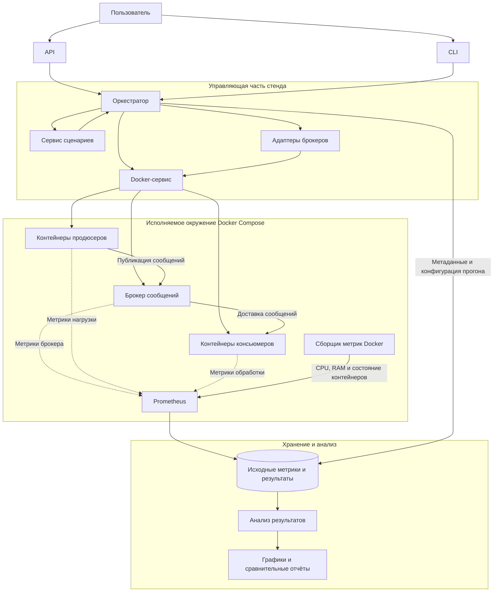

# Практическая работа 3. Критерии научности исследования и проектирование эспериментального стенда

## Анализ статей

### Таблица

| Поле                                | Maharjan et al. (2023)                                                                                                                                                                                                                                                    | Каргин (2025)                                                                                                                                                                                                                                                              | Putra et al. (2025)                                                                                                                                                                                                                                              | Макаров (2025)                                                                                                                                                                                                                                                                          | Кузьчуткомов (2020)                                                                                                                                                                                                                                                                                                                                  | Калугин (2021)                                                                                                                                                                                                                                                                                                                            |
| ----------------------------------- | ------------------------------------------------------------------------------------------------------------------------------------------------------------------------------------------------------------------------------------------------------------------------- | -------------------------------------------------------------------------------------------------------------------------------------------------------------------------------------------------------------------------------------------------------------------------- | ---------------------------------------------------------------------------------------------------------------------------------------------------------------------------------------------------------------------------------------------------------------- | --------------------------------------------------------------------------------------------------------------------------------------------------------------------------------------------------------------------------------------------------------------------------------------- | ---------------------------------------------------------------------------------------------------------------------------------------------------------------------------------------------------------------------------------------------------------------------------------------------------------------------------------------------------- | ----------------------------------------------------------------------------------------------------------------------------------------------------------------------------------------------------------------------------------------------------------------------------------------------------------------------------------------- |
| Библиографическая ссылка            | Maharjan R., Chy M. S. H., Arju M. A., Cerny T. Benchmarking Message Queues. Telecom. 2023. Vol. 4. P. 298–312. DOI: [https://doi.org/10.3390/telecom4020018](https://doi.org/10.3390/telecom4020018?utm_source=chatgpt.com)                                              | Каргин Р. А. Анализ производительности распределённых брокеров сообщений RabbitMQ и Apache Kafka. 2025. С. 91–104. DOI: [https://doi.org/10.55648/OIMM-2025-1-91](https://doi.org/10.55648/OIMM-2025-1-91?utm_source=chatgpt.com)                                          | Putra et al. Comprehensive Benchmarking of Message Brokers: Evaluating Performance and Security Metrics for Reliable Messaging Systems. Locus Journal: Research & Devotion. 2025. Vol. 4, No. 11. Полные выходные данные DOI/URL: не указано в доступном тексте. | Макаров П. С. Исследование эффективности брокеров сообщений в высоконагруженных распределённых системах // Студенческий научный журнал. 2025. Вып. 18 (314). URL: [https://sibac.info/journal/student/314/373223](https://sibac.info/journal/student/314/373223?utm_source=chatgpt.com) | Кузьчуткомов Д. Н. Разработка инструмента оценки производительности систем обмена сообщениями, основанных на брокерах, и исследование с его помощью существующих решений // Инновации. Наука. Образование. 2020. № 11. С. 178–191. URL: [https://elibrary.ru/item.asp?id=42988663](https://elibrary.ru/item.asp?id=42988663\&utm_source=chatgpt.com) | Калугин В. А. Выбор брокера сообщений для использования в качестве шины данных в рамках телекоммуникационной компании // Актуальные проблемы математики, механики и информатики: сборник статей. Пермь, 2021. С. 25–32. URL: [https://elibrary.ru/item.asp?id=46446479](https://elibrary.ru/item.asp?id=46446479\&utm_source=chatgpt.com) |
| Исследовательский вопрос / гипотеза | Как различаются брокеры по пропускной способности и задержке при разных размерах сообщений и уровнях нагрузки? Формальная гипотеза не указана.                                                                                                                            | Как размер сообщений, число узлов брокера и клиентов влияют на производительность RabbitMQ и Kafka? Формальная гипотеза не указана.                                                                                                                                        | Как уровни безопасности влияют на производительность брокеров сообщений? Формальная гипотеза не указана.                                                                                                                                                         | Какой брокер лучше подходит для высоконагруженной распределённой системы с учётом производительности, надёжности и ресурсов? Формальная гипотеза не указана.                                                                                                                            | Как сравнить пропускную способность брокеров при одинаковых условиях с помощью разработанного инструмента? Формальная гипотеза не указана.                                                                                                                                                                                                           | Какой брокер подходит для шины данных телекоммуникационной компании при переходе к микросервисной архитектуре?                                                                                                                                                                                                                            |
| Объект исследования                 | Redis, ActiveMQ Artemis, RabbitMQ, Apache Kafka.                                                                                                                                                                                                                          | RabbitMQ и Apache Kafka в распределённой конфигурации.                                                                                                                                                                                                                     | Apache Kafka, Apache Pulsar, Apache RocketMQ, RabbitMQ.                                                                                                                                                                                                          | Apache Kafka, RabbitMQ, NATS в контексте автоматизированной системы проверки студенческих работ.                                                                                                                                                                                        | Kafka, RabbitMQ, ActiveMQ, NATS, Redis, Pulsar, NSQ.                                                                                                                                                                                                                                                                                                 | Apache Kafka, RabbitMQ, NATS; сравнение технических характеристик и эксплуатационных особенностей.                                                                                                                                                                                                                                        |
| Независимые переменные (факторы)    | Брокер; размер сообщения: 10 B, 100 B, 1 KB, 10 KB, 50 KB, 100 KB; нагрузка для измерения задержки: 1, 3, 6, 10, 15 MB/s.                                                                                                                                                 | Размер сообщения: 128 B, 256 B, 512 B, 1 KB; производители и потребители: 1–5 каждого типа; число узлов брокера: 1–3.                                                                                                                                                      | Тип брокера; уровень безопасности: 0 — без защиты, 1 — TLS, 2 — TLS + аутентификация, 3 — TLS + аутентификация + ACL; размер сообщения: 10 B и 1 MB.                                                                                                             | Число производителей: 1–5; нагрузка: 1 000–50 000 сообщений/мин; размеры сообщений: 10 KB, 100 KB, 1 MB; потребители: 2–4 в многопоточном сценарии; остановка брокера на 5 секунд.                                                                                                      | Брокер; тестируемая часть — производитель, потребитель или система; размер и количество сообщений; персистентность — включена/выключена, где поддерживается.                                                                                                                                                                                         | Формализованные факторы и уровни не указаны. Рассматриваются различия брокеров, их характеристики и возможности масштабирования.                                                                                                                                                                                                          |
| Зависимые переменные (метрики)      | Пропускная способность: events/s и MB/s; сквозная задержка: 50-й, 75-й, 95-й и 99-й перцентили.                                                                                                                                                                           | Максимальная частота отправки сообщений производителем; максимальная частота получения потребителем; время передачи сообщения от производителя к потребителю. Единицы: частота сообщений в единицу времени и время передачи; точные единицы в сводном описании не указаны. | Пропускная способность: events/s; задержка: мс.                                                                                                                                                                                                                  | Средняя задержка: мс; пропускная способность: сообщений/с; потери сообщений: %; CPU: %; RAM: MB.                                                                                                                                                                                        | Пропускная способность производителя, потребителя и системы в целом: сообщений/с.                                                                                                                                                                                                                                                                    | Количественные метрики и единицы измерения не указаны.                                                                                                                                                                                                                                                                                    |
| Контролируемые условия              | Один производитель и один потребитель; единый инструмент OpenMessaging Benchmark; локально установленные брокеры.                                                                                                                                                         | Общий инструмент OpenMessaging Benchmark; настройки брокеров ориентированы на надёжность. Полный набор фиксированных условий не указан.                                                                                                                                    | Общий подход к бенчмаркингу; прочие фиксированные параметры не указаны.                                                                                                                                                                                          | Три прототипа с одинаковой схемой взаимодействия, но разными брокерами; единая тестовая среда.                                                                                                                                                                                          | Одинаковые сообщения и общие параметры испытаний; стандартные конфигурации брокеров, производителей и потребителей.                                                                                                                                                                                                                                  | Не указано.                                                                                                                                                                                                                                                                                                                               |
| Стенд                               | MacBook Air 2020, Apple M1, 16 GB RAM, SSD 512 GB. Redis 7.0.9, RabbitMQ 3.11.10, ActiveMQ Artemis 2.28.0, Kafka 3.4.0. OpenMessaging Benchmark.                                                                                                                          | Четыре многопроцессорных сервера под GNU/Linux. Точные модели CPU, объём RAM, версии ПО и параметры сети не указаны в сводном описании. Используется OpenMessaging Benchmark.                                                                                              | Используется Docker. Точные характеристики оборудования, версии брокеров и параметры контейнеров не указаны в доступном тексте.                                                                                                                                  | 4 виртуальных ядра AMD Ryzen 5 3500U 2,10 GHz; 8 GB RAM; виртуальная сеть до 1 Gbit/s; SSD 256 GB. Windows 10 Pro, Java 17, Docker 24.0, Docker Compose 2.20, PostgreSQL 14, Postman Runner, Docker stats.                                                                              | MacBook Air 13″ Early 2016; Intel Core i5 1,6 GHz; 8 GB RAM. Инструмент на Java; Maven, SLF4J и клиентские библиотеки брокеров.                                                                                                                                                                                                                      | Стенд и инструменты нагрузочного тестирования не указаны.                                                                                                                                                                                                                                                                                 |
| Методика                            | Для throughput указаны 6 размеров сообщений и 5 минут на запуск; для latency — 5 уровней нагрузки и 5 минут на запуск. В статье есть несоответствие между числом перечисленных комбинаций и заявленным общим числом экспериментов. Прогрев и порядок запусков не указаны. | Варьируются размер сообщения, число клиентов и узлов. Число повторений, прогрев, длительность и порядок запусков не указаны.                                                                                                                                               | Сравнение четырёх брокеров при разных уровнях безопасности и размерах сообщений. Число повторений, прогрев, длительность и порядок запусков не указаны.                                                                                                          | Базовая нагрузка: 1 производитель, 1 потребитель, 10 000 сообщений по 1 KB; рост нагрузки: 1–5 производителей, 1 000–50 000 сообщений/мин; сообщения 10 KB, 100 KB, 1 MB; остановка брокера на 5 секунд; 2–4 потребителя. Число повторений, прогрев и длительность тестов не указаны.   | Система целиком: 1 000 сообщений по 1 KB; производитель: 100 000 сообщений по 1 KB; потребитель: 1 000 сообщений по 1 KB. По 3 запуска каждого эксперимента; отдельно проверяется персистентность. Прогрев и порядок запусков не указаны.                                                                                                            | Подтверждённая процедура нагрузочного тестирования не указана; описан сравнительный анализ характеристик и эксплуатации.                                                                                                                                                                                                                  |
| Статистическая обработка            | Представлены графики и таблицы; для задержки используются перцентили. Доверительные интервалы, разброс и статистические тесты не указаны.                                                                                                                                 | Не указано.                                                                                                                                                                                                                                                                | Сравниваются значения задержки и пропускной способности. Доверительные интервалы и статистические тесты не указаны.                                                                                                                                              | Приведены сравнительные таблицы метрик. Доверительные интервалы, разброс и статистические тесты не указаны.                                                                                                                                                                             | Средняя пропускная способность рассчитывается по трём запускам. Доверительные интервалы и статистические тесты не указаны.                                                                                                                                                                                                                           | Не указано.                                                                                                                                                                                                                                                                                                                               |
| Угрозы валидности                   | Один производитель и один потребитель; локальный стенд не отражает распределённую сетевую среду. Результаты могут отличаться при иной конфигурации и числе клиентов.                                                                                                      | Недостаточно сведений о конфигурации брокеров и серверов; результаты зависят от настроек надёжности.                                                                                                                                                                       | Недостаточно данных об окружении и настройках для независимого повторения; влияние безопасности связано с конкретными размерами сообщений.                                                                                                                       | Один виртуализированный стенд и прикладной сценарий ограничивают обобщение результатов; отсутствие числа повторений затрудняет оценку стабильности.                                                                                                                                     | Один компьютер; стандартные настройки не гарантируют оптимальность брокеров; отдельные режимы персистентности и получения сообщений не поддерживаются всеми решениями.                                                                                                                                                                               | Сравнение характеристик не следует интерпретировать как количественное сравнение производительности под одинаковой нагрузкой.                                                                                                                                                                                                             |
| Доступность артефактов              | Указаны JSON-результаты, форк OpenMessaging Benchmark и скрипты построения графиков в `/bin/charts`. Ссылка на форк: указана авторами в статье; отдельная проверка доступности не проводилась.                                                                            | Публичный код, конфигурации и исходные данные не указаны.                                                                                                                                                                                                                  | Публичный код, данные и конфигурации не указаны в доступном тексте.                                                                                                                                                                                              | Публичный код, конфигурации Docker и исходные измерения не указаны.                                                                                                                                                                                                                     | Инструмент описан в статье; публичный репозиторий и готовые конфигурации не подтверждены.                                                                                                                                                                                                                                                            | Экспериментальный код, конфигурации стенда и набор измерений не указаны.                                                                                                                                                                                                                                                                  |
| Оценка воспроизводимости (0–3)      | 2 — есть JSON и изменённый инструмент, версии ПО, оборудование и параметры тестов; окружение и некоторые детали процедуры не зафиксированы полностью.                                                                                                                     | 1 — методика и основные факторы описаны, но артефакты и подробное окружение не подтверждены.                                                                                                                                                                               | 1 — указаны основные факторы и метрики, но недостаточно сведений о стенде и протоколе запусков; артефакты не указаны.                                                                                                                                            | 1 — описаны сценарии и стенд, но публичные артефакты не подтверждены; не хватает деталей повторения экспериментов.                                                                                                                                                                      | 1 — методика и стенд описаны, но публичный код и зафиксированное окружение не подтверждены.                                                                                                                                                                                                                                                          | 0 — недостаточно сведений даже для повторения нагрузочного эксперимента; в доступном описании не указаны измерительный протокол и стенд.                                                                                                                                                                                                  |

### Синтез результатов анализа экспериментальных исследований брокеров сообщений

Анализ шести публикаций показал, что при исследовании производительности брокеров сообщений авторы преимущественно оценивают пропускную способность и задержку доставки сообщений. Дополнительно рассматриваются потребление вычислительных ресурсов, надёжность доставки и поведение систем при отказах. При этом набор измеряемых показателей, условия испытаний и степень детализации методики существенно различаются между работами.

#### Что принято измерять и как организуются эксперименты

Наиболее распространённой метрикой является пропускная способность (throughput), характеризующая количество сообщений, обработанных за единицу времени. Она измеряется в сообщениях в секунду (messages/s или events/s), а в некоторых исследованиях также в мегабайтах в секунду (MB/s). Например, Maharjan и соавторы сравнивают Redis, ActiveMQ Artemis, RabbitMQ и Apache Kafka по пропускной способности при размерах сообщений от 10 байт до 100 КБ. Кузьчуткомов отдельно оценивает производительность производителя, потребителя и системы в целом. Такое разделение позволяет исследовать не только возможности брокера принимать сообщения, но и скорость их получения и обработки.

Вторая ключевая метрика — задержка доставки (latency), то есть время передачи сообщения от производителя к потребителю. Обычно она измеряется в миллисекундах. Maharjan и соавторы рассматривают 50-й, 75-й, 95-й и 99-й перцентили задержки, что позволяет оценивать не только типичное время доставки, но и поведение системы в случаях относительно долгой обработки. В работе Макарова задержка сравнивается при базовой и повышенной нагрузке, а также при передаче крупных сообщений. Совместное использование пропускной способности и задержки важно, поскольку высокий throughput не обязательно означает малое время ожидания для отдельного сообщения.

Некоторые публикации расширяют систему метрик. Макаров рассматривает долю потерь сообщений, загрузку процессора и потребление оперативной памяти. Также в его работе предусмотрены сценарии отключения брокера и многопоточной обработки. Это позволяет оценить не только скорость обмена, но и надёжность системы при неблагоприятных условиях. Каргин исследует влияние размера сообщения, количества клиентов и числа узлов брокера на производительность RabbitMQ и Kafka. В работе Putra и соавторов отдельным фактором выступает уровень безопасности: от работы без защиты до использования TLS, аутентификации и ACL.

Таким образом, рассмотренные работы показывают несколько распространённых способов организации экспериментов: изменение размера сообщений, увеличение числа производителей и потребителей, варьирование нагрузки, сравнение конфигураций брокера и проверка влияния дополнительных механизмов, например персистентности или защиты соединения. При этом исследование только одного режима работы не позволяет сделать полноценный вывод о поведении брокера при различных эксплуатационных условиях.

### 2. Типичные недостатки экспериментальных методик

Одна из наиболее заметных проблем — неполное описание экспериментальной процедуры. В ряде публикаций не указаны продолжительность тестов, порядок запусков, время прогрева системы и число повторений.

Вторая проблема связана с неполной фиксацией окружения и настроек. Для воспроизводимого сравнения важно знать версии брокеров, характеристики оборудования, параметры сети, конфигурацию хранения сообщений и настройки производителей и потребителей. Maharjan и соавторы указывают характеристики компьютера и версии программных продуктов, а Макаров подробно описывает аппаратную и программную среду. В других работах отдельные характеристики стенда или конфигурации брокеров остаются неуказанными. Это затрудняет прямое сопоставление результатов разных публикаций.

Также необходимо учитывать ограничения самого сценария. Например, испытания с одним производителем и одним потребителем, как в работе Maharjan и соавторов, не позволяют полностью судить о поведении брокера при большом числе параллельных клиентов. Аналогично, сравнение брокеров только в стандартных конфигурациях, как у Кузьчуткомова, полезно для оценки типичного использования, но не обязательно выявляет максимальную производительность каждого решения. В работе Калугина рассматриваются характеристики и особенности эксплуатации брокеров, однако в доступном тексте не описана воспроизводимая процедура нагрузочных измерений, поэтому её нельзя использовать как равноценный источник экспериментальных результатов.

### 3. Сравнение качества методик

Среди рассмотренных публикаций наиболее подробно экспериментальная процедура представлена в работе Maharjan и соавторов. Авторы указывают версии четырёх брокеров, характеристики тестового компьютера, размеры сообщений, уровни нагрузки и продолжительность запусков. Дополнительным преимуществом является использование OpenMessaging Benchmark для разных систем и предоставление результатов в JSON, что облегчает последующий анализ данных. Вместе с тем авторы используют одного производителя и одного потребителя, а доступное описание содержит несоответствие между перечисленными комбинациями тестов и заявленным общим количеством экспериментов. Поэтому даже наиболее подробно описанная методика имеет ограничения.

Работа Макарова особенно близка к тематике исследования брокеров при высокой нагрузке. В ней рассматриваются увеличение числа производителей, крупные сообщения, многопоточная обработка и имитация отказа брокера. Также описаны аппаратная среда, программные инструменты и несколько групп метрик. Это делает работу полезной для проектирования комплексных сценариев нагрузочного тестирования. Основной недостаток — отсутствие подробностей о повторениях и статистической обработке.

Работа Каргина полезна для исследования влияния масштабирования: в ней изменяются размер сообщений, число клиентов и число узлов брокера. Использование общего бенчмаркингового инструмента повышает сопоставимость результатов. Однако неполнота сведений о стенде и протоколе испытаний ограничивает воспроизводимость.

Кузьчуткомов предлагает важный методический подход: отдельное измерение производителя, потребителя и системы целиком, а также три запуска каждого эксперимента с расчётом средней пропускной способности. Преимущество работы — ясная структура измерений и контроль размера сообщений. Ограничение заключается в использовании одного компьютера и отсутствии подтверждённых публичных артефактов.

Работа Putra и соавторов интересна исследованием влияния уровней безопасности на производительность, однако доступных сведений недостаточно для полноценного повторения эксперимента. Работа Калугина полезна для обоснования выбора брокера с учётом требований предметной области, но её следует рассматривать как сравнительно-аналитическую, а не как подтверждённый источник результатов контролируемого нагрузочного тестирования.

### 4. Выводы для собственного исследования

Проведённый анализ показывает, что методика сравнения брокеров должна включать несколько взаимосвязанных групп показателей: пропускную способность, задержку, потребление CPU и RAM, а также надёжность доставки. Эксперименты целесообразно проводить при изменении размера сообщений, интенсивности нагрузки, количества производителей и потребителей и режима гарантии доставки. Для каждого сценария необходимо фиксировать версии брокеров, аппаратное и программное окружение, конфигурации и длительность тестирования.

Важным требованием является повторение экспериментов и сохранение исходных результатов. Помимо среднего значения желательно анализировать разброс и перцентили задержки, чтобы не ограничиваться одним агрегированным показателем. По возможности следует публиковать конфигурации запуска, исходные данные и скрипты обработки результатов.

Для разрабатываемого инструмента бенчмаркинга наиболее полезно объединить подход Maharjan и соавторов к фиксации условий и сохранению данных, подход Каргина к варьированию количества клиентов и узлов и подход Макарова к сценариям высокой нагрузки и отказоустойчивости. Это позволит не просто сравнить брокеры в одном режиме, а исследовать, как их производительность меняется при изменении нагрузки и конфигурации. Полученные результаты будут применимы к выбору брокера для конкретных условий эксплуатации, без необоснованного объявления одного решения универсально лучшим.

## Критерии научного исследования

| Критерий	                            | Как он будет выполнен в ВКР                                                                                                                                                                                                                                                                                                  | 
|--------------------------------------|------------------------------------------------------------------------------------------------------------------------------------------------------------------------------------------------------------------------------------------------------------------------------------------------------------------------------|
| Объективность и измеримость	         | Производительность оценивается по заранее определённым количественным метрикам: пропускная способность, перцентили задержки, потребление CPU и RAM, доли потерь и дубликатов. Единицы измерения и способы вычисления фиксируются до проведения экспериментов.                                                                |
| Контроль переменных	                 | В каждом сценарии изменяется один основной фактор либо заранее определённая группа факторов. Остальные параметры фиксируются. Например, при исследовании размера сообщения сохраняются постоянными интенсивность 100 сообщений/с, один производитель, один потребитель и гарантия At most once.                              |
| Повторяемость (repeatability)	       | Каждый сценарий выполняется несколько раз на одном стенде с одинаковыми версиями ПО, конфигурациями и параметрами нагрузки. Результаты запусков сохраняются отдельно, после чего сравниваются для оценки разброса. Точное число повторений необходимо определить до основного эксперимента.                                  |
| Воспроизводимость (reproducibility)	 | Другому исследователю предоставляются код инструмента, конфигурации брокеров, Docker Compose, параметры сценариев и инструкции запуска. Для фиксации окружения используются конкретные версии и идентификаторы образов контейнеров. Исследователь должен иметь возможность повторить испытания на соответствующем окружении. |
| Реплицируемость (replicability)	     | Другой исследователь должен иметь возможность реализовать эксперимент независимо от исходного кода, используя описание стенда, факторов, метрик и методики. Согласованность результатов оценивается с учётом различий в аппаратном окружении и допустимой статистической неопределённости.                                   |
| Внутренняя валидность	               | Для проверки влияния конкретного фактора фиксируются остальные параметры сценария. Запуски выполняются при сопоставимых условиях; мониторинг позволяет выявлять постороннюю нагрузку, перегрузку хоста и другие причины искажения измерений.                                                                                 |
| Внешняя валидность	                  | Используются несколько сценариев, моделирующих различные виды нагрузки веб-систем: рост числа источников сообщений, масштабирование обработчиков, крупные сообщения и публикация-подписка. Ограничения переноса результатов на реальные системы явно описываются.                                                            |
| Конструктная валидность	             | Метрики выбираются в соответствии с измеряемыми свойствами. Например, задержка измеряется от отправки до получения сообщения потребителем, а не только до подтверждения брокером записи. Надёжность оценивается по потерям и дубликатам, а масштабируемость — по изменению суммарной пропускной способности.                 |
| Статистическая валидность	           | Для каждого сценария сохраняются результаты отдельных запусков. Рассчитываются средние значения или медианы, разброс и перцентили. При наличии достаточного числа независимых измерений применяются доверительные интервалы и подходящие статистические тесты.                                                               |
| Фальсифицируемость	                  | Для каждой гипотезы заранее задаются измеряемый показатель, условия сравнения и порог практически значимого эффекта. Если эффект не достигает установленного порога или наблюдается в противоположном направлении, соответствующая гипотеза не получает подтверждения.                                                       |

### Исследовательский вопрос и гипотезы

Исследовательский вопрос (RQ):

Как характер нагрузки и требования к надёжности изменяют сравнительную эффективность брокеров сообщений с различными архитектурными моделями?

H₀ — нулевая гипотеза:

Изменение характера и интенсивности нагрузки, а также требований к надёжности не приводит к статистически значимому изменению относительных различий в производительности между исследуемыми брокерами.

H₁ — альтернативная гипотеза:

Изменение характера и интенсивности нагрузки и/или требований к надёжности приводит к статистически значимому изменению относительных различий в производительности между исследуемыми брокерами.

Исследование должно выявить не только различия между RabbitMQ, Apache Kafka и NATS, но и условия, при которых архитектурные особенности каждого брокера становятся преимуществом по одним характеристикам и ограничением по другим.

Например, более высокая пропускная способность в определённом сценарии может сопровождаться увеличением задержки, потребления ресурсов или изменением показателей доставки. Это возможные направления проверки, а не заранее установленные результаты.

### Переменные

#### Независимые переменные

| Переменная                | Значения и уровни                                                                 | Что позволяет исследовать                                                                    |
| ------------------------- | --------------------------------------------------------------------------------- | -------------------------------------------------------------------------------------------- |
| Тип брокера               | RabbitMQ, Apache Kafka, NATS                                                      | Различия между реализациями и архитектурными моделями                                        |
| Интенсивность нагрузки    | Фиксированная, постепенно увеличивающаяся, пиковая                                | Изменение эффективности при росте интенсивности и резких скачках нагрузки                    |
| Характер нагрузки         | Постоянный, линейно возрастающий, экспоненциальный, импульсный                    | Зависимость результатов от профиля поступления сообщений                                     |
| Количество производителей | От 1 до 16                                                                        | Влияние параллельной публикации сообщений                                                    |
| Количество потребителей   | От 1 до 5                                                                         | Влияние параллельной обработки сообщений                                                     |
| Размер сообщения          | 1 КБ, 8 КБ, 64 КБ, 512 КБ, 1 МБ                                                   | Влияние объёма передаваемых данных на производительность и потребление ресурсов              |
| Требования к доставке     | At-most-once, at-least-once, exactly-once (при наличии соответствующей поддержки) | Влияние гарантий доставки на производительность, надёжность и потребление ресурсов           |
| Модель взаимодействия     | Point-to-point, publish-subscribe                                                 | Влияние модели взаимодействия на маршрутизацию и распределение сообщений между потребителями |

### Зависимые переменные

| Переменная | Единица измерения | Способ измерения |
|---|---|---|
| Пропускная способность | сообщений/с | Число успешно полученных потребителями сообщений за интервал измерения, делённое на его длительность |
| Задержка доставки | мс | Разность между временем отправки и временем получения сообщения; анализ p50, p75 и p95 |
| Использование CPU | % | Средняя загрузка процессора контейнером брокера за интервал измерения |
| Потребление оперативной памяти | МБ | Средний объём RAM, используемый контейнером брокера |
| Потеря сообщений | % | Доля отправленных сообщений, которые не были получены в пределах корректно определённого эксперимента |
| Дублирование сообщений | % | Доля повторных доставок, определяемая по уникальным идентификаторам сообщений |
| Масштабируемость | коэффициент | Отношение пропускной способности при увеличенном числе потребителей к пропускной способности при одном потребителе |
| Эффективность масштабирования | % | Коэффициент масштабируемости, делённый на число потребителей и умноженный на 100% |

### Контролируемые переменные

| Переменная | Способ контроля |
|---|---|
| Аппаратная конфигурация | Использовать один и тот же компьютер или сервер с фиксированными характеристиками процессора, оперативной памяти и дисковой подсистемы |
| Операционная система | Использовать одну и ту же операционную систему и её версию |
| Версии брокеров | Зафиксировать версии RabbitMQ, Apache Kafka и NATS на протяжении экспериментов |
| Версии клиентских библиотек | Использовать зафиксированные версии библиотек для производителей и потребителей сообщений |
| Конфигурация брокеров | Зафиксировать параметры конфигурации, влияющие на обработку, хранение и доставку сообщений |
| Ресурсные ограничения контейнеров | Установить одинаковые или заранее определённые лимиты CPU и оперативной памяти для сравниваемых брокеров |
| Параметры сообщений | Фиксировать формат и содержимое сообщений, изменяя размер только в соответствующем сценарии |
| Гарантии доставки | Фиксировать режим доставки в сценариях, не посвящённых его исследованию |
| Количество производителей и потребителей | Сохранять заданное количество участников, кроме сценариев масштабирования |
| Интенсивность и характер нагрузки | Использовать одинаковый профиль нагрузки и целевые значения для сравниваемых брокеров в рамках одного сценария |
| Продолжительность эксперимента | Устанавливать одинаковую длительность прогрева и измерения |
| Сбор метрик | Использовать единые инструменты, интервалы сбора и методы расчёта показателей |
| Повторные запуски | Выполнять заранее установленное число повторений для каждого сочетания параметров |
| Порядок проведения экспериментов | Чередовать или рандомизировать порядок запусков брокеров, чтобы снизить влияние фоновой нагрузки и временных изменений состояния системы |

## Проверка результатов другими разработчиками

### Шаг 4. Как результаты проверят другие разработчики

| Что фиксируется | Способ фиксации | Инструменты |
|---|---|---|
| Исходный код | Хранение в Git-репозитории. Для каждого набора результатов фиксируются версия кода, идентификатор коммита и, при необходимости, тег релиза. | Git, GitHub |
| Зависимости | Фиксация версий используемых Python-библиотек в файле зависимостей и lock-файле. | `pyproject.toml`, `uv.lock` или `poetry.lock` |
| Окружение | Описание компонентов стенда, их версий, параметров запуска и взаимодействия. Для каждого исследуемого брокера фиксируется версия используемого образа. | Dockerfile, Docker Compose |
| Данные эксперимента | Фиксация параметров генерируемых сообщений, их размера и используемых исходных данных, если они предусмотрены сценарием. При необходимости для файлов данных рассчитываются контрольные суммы SHA-256. | SHA-256, JSON-манифест |
| Конфигурация эксперимента | Хранение сценариев в отдельных версионируемых файлах с указанием типа брокера, количества продюсеров и консьюмеров, интенсивности нагрузки, размера сообщений, гарантий доставки и продолжительности эксперимента. | YAML или JSON, Git |
| Случайность | Фиксация начального значения генератора случайных чисел, если случайность используется при формировании нагрузки или содержимого сообщений. | `random.seed()`, `numpy.random.default_rng()` |
| Запуск эксперимента | Документирование последовательности действий и предоставление стандартной команды запуска. Автоматизация подготовки окружения, запуска нагрузки, сбора метрик и завершения эксперимента. | README, Docker Compose, Makefile или CLI |
| Метаданные прогона | Сохранение идентификатора запуска, версии кода, конфигурации сценария, версий образов, времени проведения, характеристик оборудования и результатов измерений. | JSON-манифест прогона |
| Независимая проверка | Автоматический запуск тестов при изменении исходного кода, проверка корректности конфигураций и работоспособности основных компонентов системы. | GitHub Actions, pytest |

Для проведения эксперимента другой разработчик сможет получить исходный код из GitHub, установить зависимости по зафиксированным версиям, подготовить окружение с помощью Docker Compose и запустить выбранный сценарий согласно инструкции в README. Готовые сценарии экспериментов будут храниться в отдельных файлах, что позволит повторять испытания с одинаковыми параметрами и сравнивать результаты различных запусков.

Для каждого прогона будут сохраняться использованная конфигурация, версии исследуемых брокеров и программных компонентов, сведения об окружении, а также измеренные показатели производительности. Это позволит установить, при каких условиях были получены результаты, и проверить соответствие проведённого эксперимента описанной методике.

Для автоматической проверки программной реализации предполагается использовать GitHub Actions и pytest. Автоматизированные проверки будут подтверждать корректность основных компонентов, обработку конфигураций и возможность запуска тестового сценария. Полноценные нагрузочные испытания не следует считать полностью воспроизводимыми только на основании прохождения CI: их результаты дополнительно зависят от характеристик оборудования, операционной системы и фоновой нагрузки.

Каждый сценарий описывать следующей конфигурацией:

``` json
{
  "scenario_id": "123",
  "broker": "rabbitmq:4.0.0",
  "producers_count": 4,
  "consumers_count": 4,
  "message_size_bytes": 1024,
  "duration_seconds": 60,
  "load_type": "linear",
  "environment": {
    "docker_version": "...",
    "os": "...",
    "cpu": "...",
    "ram_bytes": 0
  },
  "results_file": "results.json"
}
```

## Проект экспериментального стенда

